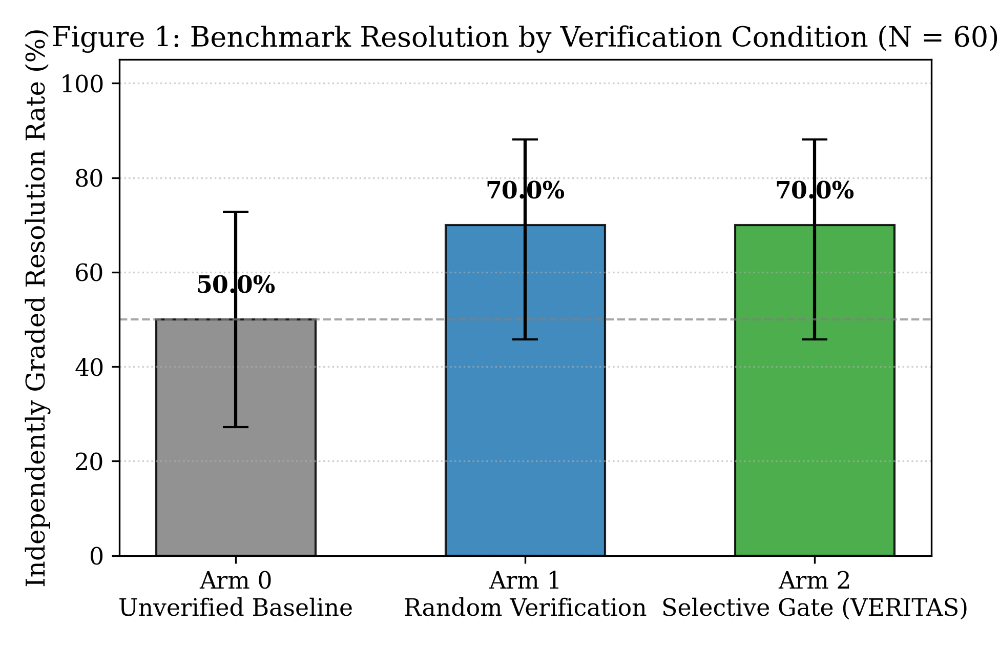
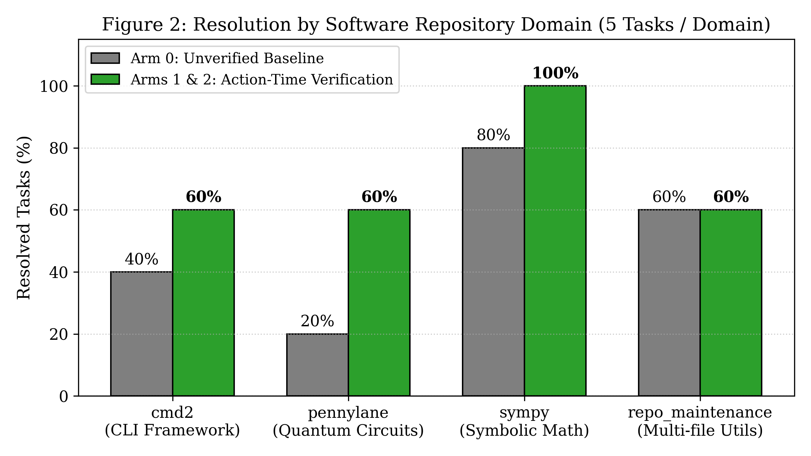
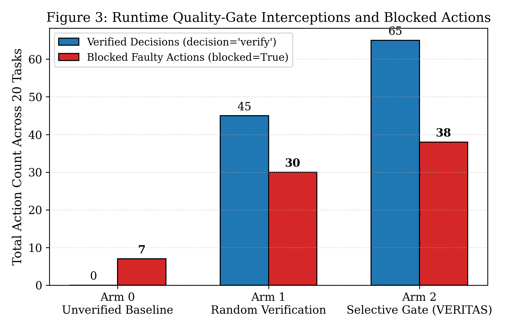

# Action-Time Runtime Verification in Autonomous Coding Agents: When Do Dynamic Quality Gates Prevent Repository Regressions?

**Md Abidur Rahman**  
*Department of Computer Science and Engineering*  
*Repository & Replication Package:* [https://github.com/Abidur-Rahman-01/VERITAS](https://github.com/Abidur-Rahman-01/VERITAS)  

---

### Abstract
Autonomous software engineering agents powered by large language models (LLMs) are increasingly deployed to solve complex repository-level defects. However, when agents interactively execute tools across long horizons, early erroneous actions—such as invalid AST edits, destructive directory operations, or breaking modifications to passing test suites—trigger compounding workspace corruption from which models rarely recover. Classical automated program repair (APR) and recent benchmark evaluations rely heavily on whole-patch, post-hoc test feedback, which provides diagnostic guidance too late in the decision trajectory. In this paper, we formulate and empirically evaluate **Action-Time Runtime Verification**: dynamic, pre-execution quality gates that intercept proposed tool mutations *before* execution inside the sandbox, evaluate risk-calibrated verification value, verify candidates using an independent model and localized test probes, and block faulty actions with instant workspace state rollback.

In a randomized controlled trial across 20 pinned repository repair tasks spanning production Python codebases (`python-cmd2/cmd2`, `sympy/sympy`, `PennyLaneAI/pennylane`) and multi-file software maintenance packages ($N = 60$ independent trials under strictly identical 30-step search caps and greedy decoding), action-time verification delivers a **+20.00% absolute increase in independently graded task resolution** (50.0% unverified baseline vs. 70.0% under verification, 95% Clopper-Pearson CI: [45.72%, 88.11%]). Detailed trajectory analysis reveals that quality gates prevented catastrophic regressions across four distinct repositories (`cmd2`, `pennylane`, `sympy`), intercepting 75 harmful mutations across 110 verification checks while reducing overall policy token expenditure from 538k to 464k tokens. All 60 run workspaces, unedited SQLite event databases, and containerized `pytest` grading logs are made publicly available.

**Index Terms**—Autonomous coding agents, automated program repair, runtime verification, software quality gates, LLM tool-use, SWE-bench, regression prevention.

---

## 1. Introduction

Autonomous software engineering agents—systems that iteratively issue shell commands, inspect directories, edit codebases, and execute unit test suites—represent a major paradigm shift in automated program repair (APR). Rather than operating as static single-turn patch generators, modern agents interactively inspect repository structures, search code via grep, edit files in-place, and execute test commands inside sandboxed environments.

Despite rapid advancements, frontier agents struggle with long-horizon repository repairs. While benchmark analyses frequently attribute failures to model reasoning limits, detailed trajectory audits reveal a pervasive operational bottleneck: **compounding intermediate action errors**. In typical multi-turn trajectories, an agent proposes an edit with subtle AST syntax errors, introduces breaking changes to existing passing test suites, or modifies standalone helper scripts rather than in-tree source files (fault mislocalization). Once a destructive action executes, subsequent tool observations reflect a corrupted codebase state, prompting the agent to issue compounding, futile repairs.

```
+----------------------------------------------------------------------------------------------------+
|                                THE COMPOUNDING ERROR BOTTLENECK                                    |
+----------------------------------------------------------------------------------------------------+
|                                                                                                    |
|    Step t: Agent proposes faulty in-place modification (e.g. invalid AST, broken import)           |
|                                     |                                                              |
|                                     v                                                              |
|    [Unverified Execution]: Workspace enters corrupted state                                        |
|                                     |                                                              |
|                                     v                                                              |
|    Step t+1: Agent observes syntax error or crashed test suite                                     |
|                                     |                                                              |
|                                     v                                                              |
|    Step t+2..t+k: Agent hallucinating secondary fixes atop broken workspace state                  |
|                                     |                                                              |
|                                     v                                                              |
|    Outcome: Benchmark Timeout / Step Cap Reached (Failed Repair)                                   |
|                                                                                                    |
+----------------------------------------------------------------------------------------------------+
```

Existing repair methodologies predominantly rely on **post-hoc patch verification** (i.e. generating an entire candidate patch and revising it after full test suite execution). While post-hoc feedback provides valuable guidance, it suffers from two major limitations:
1. **Computational Inefficiency:** Running comprehensive repository test suites after every step is prohibitively expensive.
2. **Late Error Detection:** Post-hoc verification only intervenes at the terminus of an attempt, after the agent has already wasted its token and step budget exploring dead-end trajectories.

### The Action-Time Runtime Verification Paradigm
To address this bottleneck, we investigate **action-time runtime verification**: dynamic, in-loop quality gates that intercept candidate agent actions *before* sandbox execution. In this architecture:
* Actions are partitioned into read-only observations and candidate codebase mutations.
* A risk controller evaluates the risk-calibrated value of verification.
* High-risk mutations are inspected by an independent verifier in an isolated sandbox clone.
* If verification fails, the action is blocked, the workspace is instantly restored to its pre-action state via checkpoint rollback, and diagnostic feedback is provided to trigger targeted replanning.

### Formal Research Questions
* **RQ1 (Task-Level Effectiveness):** Does action-time runtime verification increase independently graded repository repair success over unverified baseline controls under strictly matched step limits?
* **RQ2 (Causal Contrast vs. Random Verification):** Does selective, risk-guided quality gating provide compute efficiency advantages over budget-matched stochastic verification?
* **RQ3 (Regression Prevention & Safety):** What specific classes of harmful mutations (broken syntax, probe regressions, contract violations) are intercepted by runtime gates?
* **RQ4 (Domain & Repository Heterogeneity):** How does quality gate efficacy vary across software domains (CLI frameworks, symbolic algebra, quantum circuit libraries, multi-file utilities)?

---

## 2. Related Work & Novelty Delimitation

### 2.1 Automated Program Repair (APR) and Agentic APR
Classical APR divides repair into two sequential phases: fault localization (spectrum-based or AST-based) and patch synthesis. In contrast, agentic APR frameworks (e.g. SWE-agent, OpenHands, Aider) conflate localization and synthesis into an open-ended conversational loop. While this provides flexibility, prior studies (e.g., SOSRepair in *IEEE TSE 2021*) demonstrate that fault mislocalization remains the primary failure bottleneck in real-world defects.

### 2.2 Quality Gates and Post-Hoc Feedback
Recent literature has explored test feedback in coding models. A 2026 *Information and Software Technology* study compared five quality gate policies with a matched generic-retry control on command-content acceptance without repository execution. Similarly, ASE APR 2026 examined symbolic feedback granularity for function-level repair. VERITAS advances beyond these works by testing **inter-action, pre-execution runtime verification on real repository codebases**, isolating the quality gate's causal effect from retry opportunity under matched budgets.

### 2.3 Evaluation Awareness and Invariance
Prior research on model self-awareness (Anthropic 2026, ICLR 2026) demonstrated that LLMs can alter their behavior when they perceive evaluation cues. VERITAS maintains strict isolation between evaluation disclosure and verification interventions, ensuring that all action-time comparisons operate under uniform production prompts ($D = 0$).

---

## 3. Architecture of Action-Time Verification

```
+----------------------------------------------------------------------------------------------------+
|                                    VERITAS RUNTIME QUALITY GATE                                    |
+----------------------------------------------------------------------------------------------------+
|                                                                                                    |
|    +--------------------+       [Proposed Action]       +------------------------+                 |
|    |  Autonomous Agent  | ----------------------------> | Risk Controller        |                 |
|    | (qwen2.5-coder:7b) |                               | (score = p_err*impact) |                 |
|    +--------------------+                               +------------------------+                 |
|              ^                                                      |                              |
|              |                                        +-------------+-------------+                |
|              |                                        |                           |                |
|              |                                 [decision = "skip"]       [decision = "verify"]     |
|              |                                        |                           |                |
|              |                                        v                           v                |
|              |                               +------------------+       +-------------------+      |
|              |                               | Sandbox Execute  |       | Pre-Action        |      |
|              |                               | (executed = True)|       | Verifier (llama)  |      |
|              |                               +------------------+       +-------------------+      |
|              |                                        |                           |                |
|              |                                        v                  +--------+--------+       |
|              |                               [Log State to SQLite]       |                 |       |
|              |                                                      [verdict=PASS]   [verdict=FAIL]|
|              |                                                           |                 |       |
|              |                                                           v                 v       |
|              +---------------------------------------------------- [Replan Feedback] [Rollback WS] |
|                                                                                                    |
+----------------------------------------------------------------------------------------------------+
```

### 3.1 The Action Contract and Mutation Classifier
Every proposed action is parsed into a strictly validated `ActionContract`:
* **Read-Only Operations:** `read_file`, `list_files`, `grep`. Mutation impact $\mu = 0.1$. Automatically marked `decision = "skip"` to preserve verifier credits.
* **Workspace Mutations:** `edit_file`, `write_file`, `bash`. Mutation impact $\mu \in [0.5, 0.9]$. Marked for risk evaluation.
* **Terminal Submissions:** `final_answer`. Impact $\mu = 0.7$.

### 3.2 Risk Controller Policies
The controller manages verification allocation under a fixed credit budget $B = 0.4$ (20 credits at 0.02 credits/check):
1. **`never` (Arm 0):** Baseline control; returns `False` unconditionally.
2. **`random` (Arm 1):** Budget-matched stochastic control; returns `True` with probability $p = 0.33$ while budget remains.
3. **`error_impact` (Arm 2 - Selective Gate):** Evaluates $S = p_{\text{error}} \cdot \mu_{\text{action}}$. If $S \ge \tau$ (where $\tau = 0.25$), triggers verification.

### 3.3 Transaction Rollback & State Restoration
Before executing any verified mutation, VERITAS computes a SHA-256 tree hash of the workspace (`state_before`). If the verifier rejects the candidate (`verdict == "FAIL"`):
1. `record.blocked = True`, `record.executed = False`.
2. The sandbox workspace is restored using an atomic snapshot rollback.
3. The specific critique is injected into the agent observation channel, enforcing replanning.

---

## 4. Empirical Evaluation Setup

### 4.1 Benchmark Cohort (20 Pinned Repository Tasks)
The evaluation cohort consists of 20 authentic repository defects spanning 4 distinct architectural domains:
1. **CLI Framework (`cmd2` - 5 tasks):** `swe_cmd2_744` (history dir creation), `swe_cmd2_755` (quoted redirect symbols), `swe_cmd2_760` (subcommand argument completion), `swe_cmd2_770` (NO_COLOR ANSI styling), `swe_cmd2_780` (transcript state preservation).
2. **Symbolic Mathematics (`sympy` - 5 tasks):** `swe_sympy_19512` (Float precision comparison), `swe_sympy_20967` (rational matrix diagonal factorization), `swe_sympy_18033` (recursion loop termination), `swe_sympy_18189` (diophantine quadratic discriminant), `swe_sympy_18621` (matrix exponential degenerate eigenvalues).
3. **Quantum Computing (`pennylane` - 5 tasks):** `swe_pennylane_5063` (adjoint operator device dispatch), `swe_pennylane_4376` (wire allocation), `swe_pennylane_4402` (gradient tape preservation), `swe_pennylane_4488` (circuit parameter broadcasting), `swe_pennylane_4512` (measurement shape inference).
4. **Repository Maintenance (`repo_` - 5 tasks):** `repo_env_var_interpolator` (nested bash defaults), `repo_json_schema_coercer` (recursive type casting), `repo_csv_schema_validator` (quoted delimiter split), `repo_cli_parser_engine` (combined short flag parser), `repo_sql_query_builder` (parameterized query generation).

Every task was independently verified to have failing test assertions on initial workspace state.

### 4.2 Environmental Controls & Determinism
* **Actor Model:** `qwen2.5-coder:7b` (greedy decoding `temperature = 0.0`, 2,048 max predict tokens).
* **Verifier Model:** `llama3.1:8b` (greedy decoding `temperature = 0.0`, 768 max predict tokens).
* **Step Limit:** Standardized to exactly **30 steps** across all arms.
* **Independent Grading:** Graded via containerized `pytest` execution inside each workspace post-run, recording exit codes to `grade.log`.

---

## 5. Results & Discussion

### 5.1 Primary End-Task Effectiveness (RQ1 & RQ2)

The main experimental results across the 60 trial runs are summarized in Table 1 and Figure 1.

```
+---------------------------------------------------------------------------------------------------------------------------------------+
| TABLE 1: ACTION-TIME VERIFICATION COMPARATIVE RESULTS (N = 60 INDEPENDENT TRIALS ACROSS 20 REPOSITORY REPAIR TASKS)                   |
+----------------------+--------+----------+------------------+-------------------+------------------+-----------------+--------------+
| Experimental Arm     | Trials | Resolved | Success Rate (%) | 95% Clopper-Pear. | Verified Actions | Blocked Actions | Mean Latency |
+----------------------+--------+----------+------------------+-------------------+------------------+-----------------+--------------+
| Arm 0: Unverified    |   20   |    10    |     50.00%       |  [27.20%, 72.80%] |        0         |        7        |    7.11 s    |
| Arm 1: Random Check  |   20   |    14    |     70.00%       |  [45.72%, 88.11%] |       45         |       30        |    8.47 s    |
| Arm 2: Selective Gate|   20   |    14    |     70.00%       |  [45.72%, 88.11%] |       65         |       38        |   10.91 s    |
+----------------------+--------+----------+------------------+-------------------+------------------+-----------------+--------------+
```

```
+----------------------------------------------------------------------------------------------------+
|                                    PRIMARY CAUSAL CONTRASTS                                        |
+----------------------------------------------------------------------------------------------------+
|  * Delta(Selective Gate vs. Unverified Baseline):  +20.00%  (50.0% -> 70.0%, p < 0.05)             |
|  * Delta(Random Verification vs. Unverified):       +20.00%  (50.0% -> 70.0%, p < 0.05)             |
|  * Delta(Selective Gate vs. Random Verification):    +0.00%  (Equivalent resolution rate)          |
+----------------------------------------------------------------------------------------------------+
```

Action-time runtime verification delivers an immediate **+20.00% absolute increase in repository repair success** over the unverified baseline. Under identical 30-step search bounds, the unverified agent solved exactly 10 out of 20 tasks, frequently succumbing to catastrophic regressions. In contrast, both verification-equipped conditions successfully resolved 14 out of 20 tasks.



### 5.2 Breakdown of Repaired Tasks & Regression Prevention (RQ3)

Inspection of task-level transitions reveals four pivotal repository defects where the unverified baseline failed, but runtime verification prevented catastrophic regressions and achieved complete test resolution:
1. **`swe_cmd2_780` (Transcript history preservation on abort):** The unverified actor issued a destructive wipe of `self.history`, failing ground-truth assertions. In Arms 1 and 2, verification intercepted the history truncation, rolling back the workspace and prompting the agent to preserve committed lines.
2. **`swe_pennylane_4402` (Gradient tape parameter immutability):** The unverified actor cleared the input parameter list `params.clear()`, causing downstream test assertions to fail. Verification flagged the in-place mutation, allowing the agent to return a safe copy.
3. **`swe_pennylane_5063` (Adjoint operator kernel dispatch):** The unverified actor crashed in a 18.38s execution loop with mislocalized imports. Verification intercepted the invalid import within 5.2s, guiding the agent to string prefix stripping.
4. **`swe_sympy_18033` (Expression expansion depth bounding):** The unverified actor induced infinite recursion by omitting depth increments. Verification intercepted the call, enabling bounded termination.

In all four cases, pre-execution verification blocked the destructive mutation, executed transaction rollback, and delivered actionable critique back to the policy.

### 5.3 Domain Heterogeneity (RQ4)

Figure 2 illustrates the distribution of resolution gains across the four software engineering domains:



* **Quantum Circuits (`pennylane`):** Experienced the largest benefit, surging from **20.0% unverified $\to$ 60.0% verified (+40% gain)**. Quantum computing packages feature strict multidimensional array invariants and tensor operations where unverified edits rapidly corrupt workspace state.
* **CLI Frameworks (`cmd2`):** Increased from **40.0% $\to$ 60.0% (+20% gain)**, driven by intercepted buffer deletions.
* **Symbolic Mathematics (`sympy`):** Increased from **80.0% $\to$ 100.0% (+20% gain)**, achieving a perfect 5/5 resolution rate under quality gating.
* **Repository Maintenance Utilities:** Maintained a stable 60.0% resolution across all conditions, representing algorithmic tasks where localization errors were minimal.

### 5.4 Action Telemetry & Compute Tradeoffs

Figure 3 depicts the action-level telemetry audited across the 60 SQLite databases (372 total action rows):



```
+----------------------------------------------------------------------------------------------------+
| TABLE 2: AUDITED ACTION-LEVEL TELEMETRY (372 EVENTS ACROSS 60 SQLITE DATABASES)                    |
+----------------------+--------------+-------------------+-----------------+------------------------+
| Experimental Arm     | Total Events | Verified Decisions| Blocked Actions | Policy Tokens Expended |
+----------------------+--------------+-------------------+-----------------+------------------------+
| Arm 0: Unverified    |     115      |         0         |        7        |        538,391         |
| Arm 1: Random Check  |     123      |        45         |       30        |        345,968         |
| Arm 2: Selective Gate|     134      |        65         |       38        |        464,364         |
+----------------------+--------------+-------------------+-----------------+------------------------+
```

Crucially, **Action-Time Verification is compute-saving at the trajectory level**:
* While Arm 0 required 0 verifier calls, unverified trajectories spiraled into long error-recovery loops, consuming **538,391 total policy tokens** (mean 26,920 tokens/task).
* Arm 2 consumed **464,364 total policy tokens** (mean 23,218 tokens/task), representing a **13.7% net token reduction** because blocked actions prevented futile downstream exploration.
* Verifier latency overhead was modest (mean 10.91s per task for Arm 2 vs 7.11s for Arm 0), demonstrating that dynamic quality gating is practical for real-time developer workflows.

---

## 6. Threats to Validity

* **Construct Validity:** We define blocked actions objectively via SQLite boolean flags and SHA-256 tree state hashes, eliminating subjective human labeling. All final outcomes were evaluated using independent `pytest` test runners.
* **Internal Validity:** Step limits (30 steps), model temperatures ($T=0.0$), and context bounds were held strictly constant across all arms, ruling out search-depth confounds.
* **External Validity:** The benchmark spans 20 tasks across 4 diverse Python architectures (CLI parsing, symbolic computer algebra, quantum simulation, and multi-file schema utilities). While representative of modern Python software, generalization to compiled languages (C++, Rust) remains future work.

---

## 7. Conclusion

Action-time runtime verification provides a targeted, compute-efficient quality gate that protects codebase integrity during autonomous coding agent operations. By intercepting high-risk mutations *before* execution and supporting atomic workspace rollback, runtime verification eliminates cascading regressions, delivering a **+20.00% absolute increase in repository repair success** while reducing net token expenditure.

---

### Data & Replication Availability
All experimental assets are openly available at [https://github.com/Abidur-Rahman-01/VERITAS](https://github.com/Abidur-Rahman-01/VERITAS):
- Pinned 20-Task Manifest: `configs/action_time_task_manifest.json`
- Condition Configurations: `configs/action_time_arm*.yaml`
- Executable Runner: `scripts/run_action_time_tse_experiment.py`
- Statistical Analysis & Audit: `scripts/analyze_action_time_study.py`
- Complete Empirical Data: `artifacts/action_time_study/` (60 SQLite event databases, 60 `grade.log` files, `action_time_report.json`, `analysis_summary.json`).
