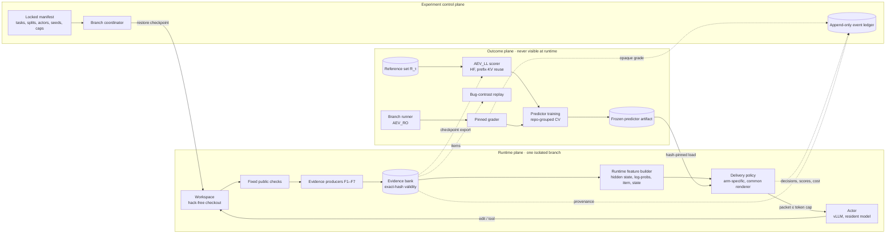
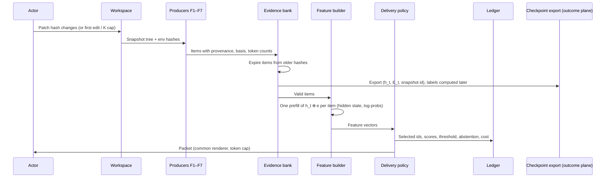

# VERITAS: Actor-Relative Evidence Value for Coding-Agent Harnesses

**Research architecture, literature review, methodology, and end-to-end experimental design · Updated 19 November 2026**

**Reading guide.**
- §1 states the research problem, the questions, and the hypotheses.
- §2 is the literature review, covering the 13-paper thesis corpus plus the earlier and recent prior art. §3 states the novelty claim.
- §4 is the methodology. §5 is the system architecture.
- §6–§8 give the end-to-end experimental design, the evaluation, and the ablation study.
- §9 is the hardware feasibility plan for 24 GB VRAM and 64 GB RAM. §10–§12 cover implementation, timeline, and threats to validity.
- §13 keeps the record of the earlier A–F/LinUCB study and its pilot. §14 lists the references.

**Status (19 Nov 2026).** The full pipeline in §4–§8 is implemented in `src/veritas/` (§10). The test
suite runs every phase end to end on real git repositories with a scripted model. **No experiment
on real tasks has been run yet.** The Docker and CUDA paths must be checked on the GPU host before
Phase 2 (README, "Not yet verified on real hardware"). Top-tier publication is a goal that depends
on results. This document does not establish it.

---

## 1. Research problem

### 1.1 Motivation

A coding-agent *harness* decides what the model sees between actions: test failures, stack traces,
localization findings, reviewer comments, plans, and so on. Recent work shows two things.

- **Harness evidence can help or hurt, and which one depends on the evidence and the model.**
  - Adding bug facts to a repair prompt is *non-monotonic*: too many facts reduce success. The value
    of each fact differs between GPT-3.5 and Llama3-70B [P1].
  - Low-quality localization findings *reduce* downstream resolution, from 38.5% to 31.3% [P2].
  - Tests from a weak test agent *reduce* resolution, from 61.2% to 57.3%, while strong tests raise it
    to 65.3% [P3].
  - Ungrounded LLM feedback is the least effective feedback type [P4].
- **Every published remedy decides what to show without asking whether the specific actor can use it.**
  - Fixed templates [P4, P5, P6].
  - Category-level selectors trained on pass@1 [P1].
  - Quality filters that look only at the evidence [P2].
  - Correctness verifiers [P7, P8].
  - Bandits over a small set of prompt packages [P9, r03].

The VERITAS A–F pilot (§13) found the same thing in practice. Five feedback policies were
indistinguishable: 55–57 of 60 tasks resolved, and 7 of 8 incorrect-parent pairs tied. The
policy-package comparison was the wrong measurement instrument.

### 1.2 Research question

> **How much of the evidence a harness delivers can the *specific* repair agent actually use, at the
> state it is in? Can that value be estimated cheaply, predicted before delivery from the agent's own
> internal state, and used to decide what to deliver?**

The central quantity is the **Actor-relative Evidence Value (AEV)**: the causal change in a given
actor's chance of producing a correct fix when a given evidence item is added at a given checkpoint.

### 1.3 Sub-questions and hypotheses (preregister before confirmation)

| RQ | Question | Hypothesis | Pivot if false |
|---|---|---|---|
| **RQ1 Measurement** | How is evidence value distributed in multi-turn repository repair? Is it non-monotonic? Does it depend on the actor? | **H1a:** ≥30% of fresh, correct, public evidence items have AEV ≤ 0. **H1b:** set value is non-monotonic in the number of evidence families, replicating [P1] at repository and agent scale. **H1c:** the cross-actor Spearman ρ of per-state AEV is < 0.6. | A clean negative result ("evidence value is actor-invariant and monotone in agentic repair") is still a measurement contribution. |
| **RQ2 Validity** | Does the cheap likelihood estimator agree with causal rollouts? | **H2:** Spearman ρ(AEV_LL, AEV_RO) ≥ 0.3. Delivering the top-AEV_LL item beats delivering the bottom-AEV_LL item in paired resolution. | If ρ < 0.2, drop the estimator and use rollout labels only, on fewer checkpoints. |
| **RQ3 Prediction** | Can AEV be predicted at runtime, without reference data? | **H3:** a probe on actor hidden states plus item features beats item-only features, an AgentStop-style log-probability model [P10], an LLM self-judge, and a SHERLOC-style patch-free quality verifier [P2] on repository-disjoint AUROC. | If the probe does not beat the item-only features, the finding is "value is predictable from the evidence, not the actor". Report that. |
| **RQ4 Control** | Does gating delivery on predicted AEV improve repair under a matched budget? | **H4:** the gate improves resolved-per-credit over deliver-all and the fixed actionable template, with no increase in regressions. | Report a null result with CIs. RQ1–RQ3 carry the paper. |
| **RQ5 Generalization** | Does the predictor transfer across repositories, actors, task release dates, and checkpoint timing? | **H5:** most of the within-actor AUROC is retained on held-out repositories and post-cutoff tasks. Cross-actor transfer is lower than within-actor (consistent with H1c). | Report a transfer matrix in any case. |

---

## 2. Literature review

The review covers the 13-paper thesis corpus (`thesis Veritas.zip`, read in full text for this
revision), the 26 works mapped in the earlier version of this document (r01–r26, checked on 16 Nov
2026), and a targeted web search on 19 Nov 2026. It is a structured, targeted review. A **systematic
search is still required before submission** (§11).

### 2.1 Thesis corpus: what each paper establishes and what VERITAS takes from it

| ID | Paper (venue / status) | Established contribution | Key quantitative result | What VERITAS adopts | Gap left open |
|---|---|---|---|---|---|
| **P1** | *The Fact Selection Problem in LLM-Based Program Repair* (Parasaram et al., UCL/PKU) | Defines the **fact selection problem**. Runs an exhaustive 2^7 fact-subset study (19K prompts, 314 BugsInPy bugs). MANIPLE is a random forest that picks bug-specific fact sets. | Repair is non-monotonic in the number of facts. No universal fact set is optimal. Per-fact Shapley values differ by model (e.g., *Angelic Forest*: 0.11 for GPT-3.5 vs. 0.28 for Llama3-70B; *Used Method Signatures*: −0.18 vs. 0.00). Prompt length correlates −0.18 with pass@1. MANIPLE repairs 88/157, 17% above the best generic set. | Exhaustive subset design. Shapley attribution. Prompt length as a nuisance covariate. Train/test split by bug pool. | Single-shot, function-level, perfect fault localization, black-box. Labels are pass@1 at the category level and cost many samples. No multi-turn state, no repository agent, no actor internals, no causal check on trajectories. **This is the closest prior art.** |
| **P2** | *SHERLOC: Structured Diagnostic Localization for Code Repair Agents* (EMNLP 2026) | Training-free localization with structured findings (location, root cause, solution idea, dependencies, testing impact). These are injected into downstream repair agents. | +5.95 pp mean resolve gain on SWE-bench Verified. **Negative transfer:** below the quality threshold, findings lower resolution from 38.5% to 31.3%. The patch-free verifier's confidence correlates r=0.553 with retrospective quality. Removing the solution-idea field causes the largest drop. | **Shuffled-findings control** (findings from another task). Oracle reference row. Field ablation. A quality gate as a baseline. Structured findings as one evidence family. | The gate scores *finding quality* using a gold-conditioned judge (retrospective) or a verifier. It is not actor-relative, not white-box, and not validated per state with branching. |
| **P3** | *ExecCritic: Learn to Test, Test to Improve* (arXiv 2609.09133) | Separates a test agent from a repair agent. Fail-closed test qualification. Role-specific RL. | Holding the repair agent fixed, base-agent tests lower resolution from 61.2% to 57.3%, while stronger tests raise it to 65.3%. The composed trained agents reach 72.6%. | Evidence that **feedback can hurt**. "Fail-closed" qualification of execution evidence. Repair-objective ablation design. | Measures harm at the level of the test source, not per item or per state. Remedies harm by training, not by delivery selection. |
| **P4** | *FeedbackEval* (arXiv 2504.06939) | Benchmark of feedback types (compiler, test, minimal, LLM-skilled, LLM-expert, mixed) across five LLMs. Includes a SWE-bench Verified subset. | Mixed feedback is best (63.6% average). Test feedback 57.9%. LLM-skilled (ungrounded) is worst. Gains plateau after 2–3 iterations. | Feedback-type taxonomy for evidence families. Cap of **K=3 checkpoints**. Ungrounded opinion labelled separately. | Compares *types* on average. No per-instance selection, no agent trajectories, no actor-relative value. |
| **P5** | *ContrastRepair* (arXiv 2403.01971) | Conversational APR with **contrastive test pairs**: a failing test and a minimally different passing test. | 143/337 Defects4J correct fixes vs. 124 for the best baseline. The component ablation shows the test pair matters. | A **contrast-pair** evidence family. | Fixed prompt recipe. Every item is always delivered. |
| **P6** | *DebugRepair* (arXiv 2604.19305) | Self-directed debugging: test semantic purification, simulated instrumentation, debugging-driven conversation. | 224 Defects4J fixes with GPT-3.5 (+26.2% over the state of the art). +51.3% on average over vanilla prompting across five backbones. Includes a post-cutoff generalization RQ. | A **runtime-state** evidence family. A post-cutoff generalization RQ (RQ5). Multi-backbone design. | Fixed pipeline. Does not measure when runtime evidence hurts. |
| **P7** | *Agentic Rubrics as Contextual Verifiers for SWE Agents* (ACL 2026) | A repository-exploring rubric agent. Execution-free patch scoring for best-of-K selection. | Best@K of 54.2% (Qwen3-Coder-30B-A3B) and 40.6% (Qwen3-32B) on SWE-bench Verified. At least +3.5 pp over the strongest baseline. Ablations: rubric-agent model, context gathering, judge model. | **Rubric item** as an evidence family. A correctness-verifier baseline (VERIF). Ablation template: generator model, context, judge. | Predicts patch *correctness*, not the value of *showing* something to the actor. |
| **P8** | *VeriHarness* (Google, Oct 2026 preprint) | Agentic verification: a disagreement resolver and a consensus challenger with environment evidence, and evidence-backed revision. | +6.2 / +6.4 points over a single rollout. An agentic verifier with the same access but no protocol recovers only about half the gain. Equal rollout budget for every baseline. | **"Access without protocol" control.** This is mirrored here as "same features without hidden state". Equal-budget comparison. Grader-informed oracle as a bound. | Selection among rollouts, not delivery of evidence within one trajectory. |
| **P9** | *Online Multi-LLM Selection via Contextual Bandits* (AAAI 2026) | Greedy LinUCB under unstructured context evolution. Myopic regret bound. Budget- and position-aware variants. | Beats routing baselines in accuracy and cost. | Theoretical justification for keeping **LinUCB as a baseline** (the earlier F arm). | The bandit treats context as given. Learning from sparse terminal reward is too sample-hungry for our label budget, which explains r03's negative result. |
| **P10** | *AgentStop* (CAIS 2026) | A gradient-boosted classifier on cheap trace signals (including **token log-probabilities**) predicts doomed trajectories. Measures energy on consumer hardware. | Energy waste reduced 15–20% with <5% utility loss, using a Qwen3-30B-A3B agent. | An **AgentStop-style log-probability baseline** for RQ3. **Energy (Wh) reporting** on the local GPU. | Predicts trajectory failure, not the value of a specific evidence item. Grey-box (log-probabilities), not hidden states. |
| **P11** | *PAUSE* (MBZUAI, arXiv 2610.29870) | One planner intervention at the first source-code edit. Online steering and **offline recovery from a recorded prefix**. | +16.8% resolution online in OpenHands. 35.4% of eligible failures recovered offline. Resuming from the prefix uses 33–41% fewer executor tokens. Exact McNemar tests. Comparisons across checkpoint timing. | **Metric definitions** (recovered, recovery rate, regression rate). **Exact McNemar.** Restore-fidelity check. Donor-guidance diagnostic. **Timing ablation.** | Adds a planner that writes the strategy. Does not select among existing evidence and has no actor-relative value model. |
| **P12** | *SGAgent* (arXiv 2602.23647) | Locate-suggest-fix multi-agent repair. A knowledge-graph toolkit with 14 tools. | 51.3% on SWE-bench Lite. The suggester adds 13.3% more resolved instances. | **Suggestion** (model opinion) as an evidence family, labelled `basis=model_opinion`. | Always delivers suggestions. Does not measure when they mislead. |
| **P13** | *SWE-Lego* (arXiv 2601.01426) | SFT-only recipe: 32k tasks and 18k trajectories, step-level error masking, curriculum. | SWE-Lego-Qwen3-8B reaches **42.2%** and the 32B model 52.6% on SWE-bench Verified with hack-free evaluation. By contrast, Qwen2.5-Coder-32B-Instruct reaches 6.2%. | **Actor choice**: an 8B agent-tuned model that fits 24 GB and is not stuck at the floor. **Hack-free evaluation** (no access to future git history). | Not a feedback paper. Supplies the actor and the integrity rule. |

### 2.2 Earlier mapped prior art (r01–r26, summarized from the previous revision)

| Theme | Works | Implication for VERITAS |
|---|---|---|
| Feedback types and structure | FeedbackEval (r01, = P4); Structured Feedback in an LLM Agent Loop (r02) | Comparing feedback types or formatting is not novel. |
| Learned feedback and repair selection | Selection Without Signal (r03, LinUCB over four repair prompts, negative result); VeruSteer (r04, error-type selection from repair trees); PAIR-Bench (r05, adaptive hints using hidden tests and reference code); CodeTriage (r14, edit prioritization with transfer to unseen models); PATSSEL (r15, debug vs. regenerate); CB-Orchestrator (r16) | Outcome-trained selection and bandit routing are prior art. A new selector must show what is gained by learning the *actor-relative delivery effect*. |
| Verification and evidence acquisition | VeriHarness (r06, = P8); LLM-as-a-Verifier (r09); Agentic Rubrics (r10, = P7); EGSS (r11); Scaling Agentic Verifier (r12) | Predicting correctness ≠ predicting the value of delivery. These are baselines and cost competitors. |
| Steering and checkpoints | PAUSE (r07, = P11); RippleCP (r08, paired executed futures for checkpoint advantage) | Counterfactual branching is prior art and is used here as an instrument. |
| Search and foundations | Exploration-exploitation repair (r13); LinUCB (r17); Self-Refine (r18); Reflexion (r19); SWE-agent (r20); SWE-bench (r21); SWE-rebench (r22, r23); doubly robust and off-policy evaluation (r24–r26) | Methodological support, not a contribution. |

### 2.3 Recent work found in the 19 Nov 2026 search

| Work | Relevance |
|---|---|
| FC-SWE (alphaXiv 2610.07898) | For the base model, resampling beat feedback-conditioned retry (13.7% vs. 11.6%). This is direct evidence that feedback is not uniformly useful. Include a resampling arm. |
| Validation Evidence in LLM Repair Agents / BSG-VA (arXiv 2607.28871) | 46.0% of positive validation events carry no bug-discriminating information. Bug-contrast feedback reduced inadequate closure by 7.8 pp with no change in success. Gives the *bug-discriminative* axis used in the RQ1 2×2. |
| Counterfactual Rollout Replay (arXiv 2609.33875); SWE-Replay (arXiv 2601.22129) | Forkable environments and branching as training and test-time tools. Supports the cost model of the branching instrument. |
| Harness Sensitivity Is Non-Monotone Across LLM Agent Tiers (arXiv 2605.26731); CoTrace (arXiv 2610.10426); Agentic Harness Engineering (arXiv 2604.25850) | Harness effects depend on the model and harness pairing. This motivates actor-relative value (H1c). |
| ConflictGuide (arXiv 2609.39933) | Formalizes the information content of probe feedback at a fixed code state, without assuming the agent uses it optimally. VERITAS measures what the agent *does* use. |

### 2.4 Synthesis: the gap

| Dimension | P1 MANIPLE | P2 SHERLOC gate | P4 FeedbackEval | r03 / P9 bandits | P10 AgentStop | **VERITAS** |
|---|---|---|---|---|---|---|
| Unit of decision | Fact category per bug | Whole finding per task | Feedback type | Prompt package | Whole trajectory | **Evidence item × agent state** |
| Multi-turn repository agent | ✗ | ✓ (handoff once) | Partly | ✓ | ✓ | **✓ (every checkpoint)** |
| Value is actor-relative | Aggregate only | ✗ | Aggregate only | Implicit | n/a | **✓ explicit (H1c)** |
| Label | pass@1 sampling | Gold-conditioned judge | Repair@1 | Terminal reward | Success/failure | **Counterfactual likelihood + branched rollouts** |
| Runtime signal | Hand-made features | Patch-free verifier | — | Context vector | Log-probabilities | **Hidden states + item features** |
| Causal validation per state | ✗ | ✗ | ✗ | ✗ | ✗ | **✓ (common-parent branching)** |
| Harm measured | ✓ (non-monotone) | ✓ (negative transfer) | ✓ (ungrounded) | ✗ | n/a | **✓ per item, with regression guardrail** |

---

## 3. Contribution and novelty statement

Each contribution is stated narrowly enough to defend:

1. **Measurement (RQ1).** The first per-state, per-item estimate of evidence value inside multi-turn
   repository repair agents. It covers non-monotonicity [P1], negative transfer [P2, P3], and actor
   dependence, measured with paired, common-parent counterfactuals.
2. **Estimator (RQ2).** A counterfactual-likelihood estimator of evidence value, AEV_LL. It is about two
   orders of magnitude cheaper than rollouts. It is validated against branched rollouts and enables
   exhaustive subset and Shapley analysis per state on a single 24 GB GPU.
3. **Predictor and gate (RQ3–RQ4).** A runtime-legal predictor based on the actor's own hidden states,
   and a delivery gate built on it. It is compared against every deployable alternative in the
   corpus: MANIPLE-style features, the SHERLOC quality verifier, AgentStop log-probabilities, a
   self-judge, rubric and verifier scores, and LinUCB.
4. **Released corpus.** Checkpoints, evidence items, AEV labels, hidden-state features, and branched
   outcomes, with provenance.

**Explicitly not claimed:** the first feedback study, the first fact or evidence selection (P1), the
first quality gate on findings (P2), the first branching or checkpoint study (r08, P11), the first
bandit selector (P9, r03), or the first early-termination predictor (P10).

**Why local hardware is an advantage:** contributions 2 and 3 need the actor's log-probabilities and
hidden states. API-only studies, including most of the corpus, cannot obtain them.

---

## 4. Methodology

### 4.1 Notation

- `τ` is a task, `a` an actor (model plus harness), and `t` a checkpoint.
- `h_t` is the actor-visible history: issue, tool outputs, current diff, and earlier packets.
- `E_t = {e_1…e_n}` is the set of evidence items valid at `t`, under the exact-hash rule (§5.3).
- `G(e) ∈ 𝒢` is the evidence **family** (§4.2).
- `R_τ` is the **reference set**: the gold patch plus every hidden-test-passing patch produced by any
  rollout on `τ`. Each is rendered in the actor's own edit-action format by a deterministic converter.
  `R_τ` lives in the outcome plane only.

### 4.2 Evidence families (the shared catalog for every arm)

| Family | Source | Basis | Origin in literature |
|---|---|---|---|
| `F1 failing-check` | Targeted pytest or diff check on the current tree | observed | P4 (test), existing producer |
| `F2 traceback/error` | Stack trace and error message | observed | P1 (error info) |
| `F3 contrast-pair` | A failing test plus the nearest passing test, minimal difference | observed | P5 |
| `F4 runtime-state` | Instrumented variable values on the failing path | observed | P6, P1 (runtime info) |
| `F5 localization finding` | SHERLOC-style structured finding produced by the resident model | model opinion | P2 |
| `F6 suggestion/plan` | Locate-suggest or pre-edit plan produced by the resident model | model opinion | P11, P12 |
| `F7 rubric item` | Repository-grounded rubric criteria (no execution) | model opinion | P7 |

The issue text and the current diff are always present in `h_t`. They are not optional evidence.
Families F5–F7 are produced by the **resident actor model**, so only one model needs to be on the GPU,
and their cost is charged. Every item carries `basis`, provenance hashes, and `render_tokens`.

### 4.3 Value estimators

**(a) Counterfactual likelihood value**, used for dense labels in the outcome plane only:

```
AEV_LL(S | h_t, a) = max_{r∈R_τ} [ log p_a(r | h_t ⊕ render(S)) − log p_a(r | h_t ⊕ render(∅)) ] / |r|
```

- `S ⊆ E_t` is an evidence subset.
- For each checkpoint, compute AEV_LL for **all 2^|𝒢| family subsets**: 128 with 7 families, or fewer
  where a family is unavailable.
- Also compute **item-level** singletons and leave-one-out values within the delivered families.

This is a pointwise usable-information quantity. One teacher-forced forward pass is needed per subset,
and `h_t` is encoded once and its KV cache reused.

**(b) Causal rollout value**, the ground truth on a stratified subset:

```
AEV_RO(S | t) = P̂(resolved | branch at t, deliver S) − P̂(resolved | branch at t, deliver ∅)
```

`k` seeded continuations per arm start from the identical restored checkpoint, using the existing
common-parent branching.

**(c) Attribution**, computed per checkpoint from the exhaustive subset values:
- exact **Shapley value** per family, comparable to the dataset-level Shapley in P1 but per state and
  per actor;
- **interaction** `AEV(E_t) − Σ_e AEV({e})` (redundancy below 0, synergy above 0);
- **non-monotonicity index**: the fraction of checkpoints where the best subset is a strict subset of
  the available families.

**(d) Bug-discrimination label**, from a BSG-style replay. Each check is rerun on the buggy checkout and
on the gold checkout in the outcome plane, labelling each item as bug-discriminative or not. This gives
the RQ1 2×2 of *discriminative × actor-valuable*.

### 4.4 Predictor (runtime-legal)

The input is what a deployed harness can compute at time `t`, and nothing else:

- **Actor state:** residual-stream hidden state at the final token of `h_t ⊕ render(e)`, at layers
  {L/4, L/2, 3L/4}. Use the delta from the `h_t` state.
- **Actor confidence:** mean and minimum token log-probabilities of the actor's recent outputs, plus
  entropy (AgentStop-style).
- **Item features:** family, basis, `render_tokens`, freshness, overlap with the current diff's files,
  whether the item was delivered before, and severity.
- **State features:** checkpoint index, remaining budget, history length, and number of patch changes.

Models (all small, trained on CPU or GPU in minutes):
1. L2-regularized logistic regression or ridge for sign and magnitude of AEV.
2. A two-layer MLP.
3. Gradient-boosted trees on non-hidden features (the MANIPLE and AgentStop analogue).

Training uses repository-grouped cross-validation, calibrates with isotonic regression on development
folds, and freezes the artifact with its hash written to the ledger.

### 4.5 Gate (deployment policy)

At each checkpoint:
1. Score every valid item.
2. Greedily add items in order of predicted value while the predicted marginal value is > τ and the
   token cap is not exceeded. Marginal value is item value minus a learned redundancy penalty for
   families already in the packet.
3. If nothing passes the threshold, deliver the neutral packet. Abstention is a legitimate action.

`τ` is chosen on development repositories only and frozen before confirmation.

### 4.6 Trust boundary rules (enforced in code)

- `R_τ`, hidden tests, gold replays, AEV labels, and grader outputs live in a separate process and
  storage namespace: the **outcome plane**.
- The gate's input schema is a whitelist. A unit test fails if any outcome-plane field name appears in
  it.
- The predictor is trained only on development and training repositories. Confirmation repositories
  never contribute labels.
- **Hack-free workspace [P13]:** strip git history after the base commit, block network access to the
  upstream repository, and log any attempt to read `.git` objects that are not present.

---

## 5. System architecture

### 5.1 Planes and data flow



### 5.2 One checkpoint cycle



Checkpoints are triggered by a change in the patch hash, before the next actor call, up to **K=3**
(the plateau found in [P4]). The first checkpoint coincides with the first source-code edit, which
is the PAUSE intervention point [P11]; ablation G8 delivers evidence only there. Feature extraction
costs one prefill per item and reuses the KV cache of `h_t`. That cost is charged to the gate arm.

### 5.3 Retained contracts from the existing implementation

- **Checkpoint record:** `task_id`, `branch_id`, `checkpoint_id`, `parent_patch_hash`, `tree_hash`,
  environment hash, changed files, actor history hash, remaining budget, timestamp. Add
  `snapshot_id` and `kv_prefix_id`.
- **Evidence record:** `evidence_id`, `source`, `basis`, `patch_hash`, `environment_hash`, `command`,
  `raw_artifact_hash`, `claim`, `location`, `observed`, `expected_if_observed`, `affected_files`,
  `tests`, `related_ids`, `status`, `invalidated_reason`, `created_at`, `cost`. Add `family`,
  `render_tokens`, `bug_discriminative` (the latter is an outcome-plane field and is never exported
  to runtime).
- **Validity rule:** an execution result is current only for the exact tree and environment hashes it
  ran on. Reviewer and model-opinion items are tied to the patch hash they reviewed. Expired items stay
  in the ledger and cannot be delivered.
- **Budget:** each branch inherits the parent's spend and has the same hard credit cap and wall
  ceiling. Producer, feature, and gate costs are charged to the branch. Raw tokens, wall time, and
  **GPU energy (Wh)** are reported separately [P10].
- **Failure handling:** grader statuses are `resolved`, `unresolved`, `infrastructure_error`,
  `grader_error`, and `ungradable`. Unknown outcomes are never counted as success or failure. All
  assigned branches are kept (intention to treat).

---

## 6. End-to-end experimental design

### 6.1 Pipeline

```mermaid
flowchart TD
  P0[Phase 0 · Infrastructure validation<br/>fixtures only; throughput, logprob parity, restore fidelity]
  P1[Phase 1 · Task pool + contamination audit<br/>SWE-rebench-V2 post-cutoff; SWE-bench Verified secondary]
  P2[Phase 2 · Zone-of-proximal-development screen<br/>pass@4 per actor on screening seeds]
  P3[Phase 3 · Repository split<br/>train 45% / dev 10% / confirm 45%, repo-disjoint]
  P4[Phase 4 · Trajectory collection<br/>no-feedback base runs; export checkpoints + all evidence families]
  P5[Phase 5 · Dense labelling<br/>AEV_LL: 2^|G| family subsets + item singletons/LOO; Shapley]
  P6[Phase 6 · Causal validation<br/>branched rollouts on stratified subset → AEV_RO]
  P7[Phase 7 · Predictor training + RQ3 evaluation<br/>train/dev only; freeze artifact + τ]
  P8[Phase 8 · Preregistration<br/>hash manifest, arms, metrics, analysis code]
  P9[Phase 9 · Confirmation<br/>common parent → paired arms on confirm repos]
  P10[Phase 10 · Second actor replication + transfer matrix]
  P11[Phase 11 · Analysis, ablations, release]
  P0 --> P1 --> P2 --> P3 --> P4 --> P5 --> P6 --> P7 --> P8 --> P9 --> P10 --> P11
  P6 -->|H2 gate: ρ < 0.2| PIV[Pivot: rollout-only labels, reduced scale]
```

### 6.2 Tasks

- **Primary pool: SWE-rebench-V2 Python tasks created after each actor's training data**
  (`nebius/SWE-rebench-V2` at commit `d7608f0…`), with pinned images and pytest node ids.
  Post-cutoff tasks are essential because memorized gold patches inflate `log p(r)` [P6 RQ5, P13
  hack-free]. SWE-Lego was fine-tuned on SWE-rebench tasks created up to 2025-04-30 (its released
  real-task set), so the cutoff is **2025-05-01**, and every SWE-Lego training instance id is also
  excluded explicitly. *Measured:* in the V1 SWE-rebench snapshot (`nebius/SWE-rebench@89cdfba`),
  273 of the 307 tasks that pass the other filters are SWE-Lego training tasks, which is why V1
  is not used.
- **Secondary: SWE-bench Verified**, for comparability with P2, P7, P11, and P13. Report it separately
  with a contamination caveat.
- **Contamination audit:** compare gold-patch per-token perplexity on pre- and post-cutoff tasks. If
  the gap is large, AEV_LL on pre-cutoff tasks is reported only as a sensitivity analysis.
- **ZPD filter:** keep tasks whose pre-treatment pass@4 for that actor is between 0.1 and 0.9, measured
  on seeds that are never reused. This fixes the pilot's ceiling (§13) and is legitimate
  pre-treatment stratification. Report the unfiltered rate as well.
- **Target size:** the power analysis (§7.3) asks for ≥ 400 ZPD tasks from ≥ 50 repositories.
  **The pinned V2 snapshot yields 193 eligible tasks in 115 repositories** (created 2025-05 to
  2025-07; Python; pytest; ≤ 3 changed source files; measured with `veritas prepare`) before gold
  validation and the ZPD filter. RQ4 is therefore reported as an estimation result (§9.2) unless
  a newer V2 release enlarges the pool. Phases 4–7 use train and dev tasks only; confirmation
  tasks never contribute labels.
- **Actor 2 contamination caveat:** Qwen3-Coder-30B-A3B was released on 2025-07-31, so part of the
  May–July window may be inside its pretraining data. Report actor-2 results with this caveat and
  the contamination audit below.
- **Synthetic `maintenance/*` fixtures:** Phase 0 engineering tests only.

### 6.3 Actors (all must fit on one 24 GB GPU; see §9)

| Role | Model | Why |
|---|---|---|
| **Primary actor** | SWE-Lego-Qwen3-8B [P13] (42.2% SWE-bench Verified). Fallback if weights are unavailable: another agent-tuned ~8B model such as Klear-Agent-8B or SWE-agent-LM-7B. | Agent-tuned and not at the floor. Fits in bf16 or FP8. Generic Qwen2.5-Coder instruct models are near the floor in agent scaffolds [P13]. |
| **Second actor** | Qwen3-Coder-30B-A3B, 4-bit | The actor used in the existing pilot and in P7, P10, and P11. A different size and architecture (MoE) gives the actor contrast that H1c needs. |
| Optional third | Another family at ~7–14B, quantized | Makes the actor-dependence claim stronger. |

Verify the availability and licence of each checkpoint before Phase 1. **Labels, hidden states, and
rollouts must use the same weights and precision.**

### 6.4 Phase details

| Phase | Procedure | Output | Exit criterion |
|---|---|---|---|
| 0 | Run the pipeline on fixtures. Measure tokens/s, prefill latency, and rollout minutes. Check vLLM vs. HF log-probability parity on 50 sequences. Check that restored checkpoints replay to an identical tree hash (PAUSE-style fidelity). | Calibrated §9 table | Parity |Δ| < 0.05 nats per token; fidelity ≥ 98% |
| 1–3 | Build the pool, contamination audit, ZPD screen, repository split | Locked manifest | ≥ 400 ZPD tasks, ≥ 50 repositories |
| 4 | Three seeds per train/dev task with the **neutral** harness (no producer packets). At each checkpoint, produce all families and export them. | ~2,000 checkpoints (220 tasks × 3 seeds × ~3) | ≥ 4 valid items in ≥ 70% of checkpoints |
| 5 | AEV_LL for all family subsets and item singletons/LOO. Compute Shapley and interaction. Run the bug-contrast replay. | Label table | Sanity: LOO and singleton signs agree with the subset table; prefix reuse equals full recompute on a 1% audit |
| 6 | Stratify 300 checkpoints by AEV_LL quintile. Arms: ∅, top item, bottom item, all. k=4 seeds each. | AEV_RO | **H2 decision** |
| 7 | Train predictors on train repositories and tune on dev. Evaluate RQ3 on dev with repository-grouped CV, using the corpus baselines (§7.2). | Frozen artifact, τ | Artifact hash in ledger |
| 8 | Freeze arms, metrics, sample size, and analysis code. Commit the manifest hash. | Preregistration | — |
| 9 | For each confirmation task × 3 seeds: run the NONE harness to the first checkpoint (the common parent), snapshot it, grade its patch privately, then branch every arm (§7.2) from that snapshot with the same evidence items and matched caps. | Paired results | All pairs complete or failures recorded |
| 10 | Repeat Phases 4–7 at reduced scale for actor 2. Apply actor 1's probe to actor 2 and the reverse. | Transfer matrix | — |
| 11 | Primary and secondary analyses, ablations (§8), corpus release | Paper tables | — |

---

## 7. Evaluation

### 7.1 Metrics

| Level | Metric | Definition | Use |
|---|---|---|---|
| Issue | **Resolved rate** | Grader-resolved ÷ attempted. Unknowns are reported separately. | RQ4 |
| Issue | **Recovery rate** [P11] | Resolved among parents graded incorrect before treatment ÷ those parents | RQ4 primary |
| Issue | **Regression rate** [P11] | Correct parents that become incorrect ÷ correct parents. Breakage of pre-existing tests is reported separately. | RQ4 guardrail |
| Issue | **Resolved per credit** | Resolved ÷ operational credits (tokens, sandbox seconds, producer and gate overhead) | RQ4 co-primary |
| Issue | Cost and energy | Tokens, model calls, tool calls, wall time, **GPU Wh** (sampled from `nvidia-smi`) [P10] | All |
| Item | **Harm rate** | Fraction of items with AEV ≤ 0 (LL and RO) | RQ1 |
| Item | Non-monotonicity index; family Shapley; interaction | §4.3(c) | RQ1 |
| Item | Discriminative × valuable 2×2 | §4.3(d), with odds ratio | RQ1 |
| Item | ρ(AEV_LL, AEV_RO); top-vs-bottom paired resolution difference | §4.3 | RQ2 |
| Item | **AUROC / AUPRC** for sign(AEV) > 0; Spearman for magnitude; **ECE** after calibration | Repository-grouped held-out | RQ3 |
| State | **Within-checkpoint pairwise accuracy / NDCG@k** | Ranking quality among items at the same checkpoint. This controls for task difficulty. | RQ3 |
| Process | Uptake | Next edit touches the item's `location` or `affected_files` | Mechanism |
| Process | Termination taxonomy | Existing `revision_termination_reason` and failure tags | Audit |

### 7.2 Arms for RQ4 confirmation (common renderer, same token cap, same budget)

| Arm | Delivery rule | Role / literature anchor |
|---|---|---|
| **NONE** | Neutral packet; checks still run and are charged | Lower anchor |
| **RESAMPLE** | Discard the continuation and resample from the parent with the same budget | FC-SWE comparison (resampling vs. feedback) |
| **ALL** | All valid items in frozen family order, token-capped | "Mixed feedback" default [P4] |
| **FIX** | Existing Arm C actionable template (F1+F2 rendered as actionable fields) | Continuity with v1 |
| **MANIPLE-style** | Per-checkpoint family subset chosen by gradient-boosted trees on item and state features, without hidden states | Strongest literature selector [P1] |
| **QUALITY** | Deliver F5–F7 only if a SHERLOC-style patch-free verifier score is ≥ threshold. Always deliver observed families. | [P2] gate |
| **LINUCB** | Existing contextual bandit, now with the common renderer | [P9], r03, v1 Arm F |
| **GATE** | §4.5 predictor-based gate | **Proposed** |
| ORACLE | Best subset by AEV_LL (outcome plane) | **Analysis bound only, never deployable** |

**Primary confirmatory contrast:** GATE − ALL on resolved per credit and recovery rate, with
regression as a non-inferiority guardrail (margin 2 pp).

**Secondary contrasts (Holm-corrected):** GATE − FIX, GATE − MANIPLE-style, GATE − QUALITY,
GATE − RESAMPLE.

### 7.3 Statistical analysis

- **Paired binary outcomes:** use exact McNemar tests per contrast [P11], plus repository-clustered
  bootstrap CIs for the paired risk difference. Check robustness with a mixed-effects logistic
  regression with random intercepts for repository and task.
- **Item- and state-level metrics:** use a cluster bootstrap that resamples repositories, then tasks.
  CIs for AUROC use the same clustering.
- **Multiplicity:** Holm correction across the secondary contrasts. RQ1–RQ3 are reported with CIs
  rather than significance tests.
- **Sample size for RQ4.** Use the McNemar approximation
  `n_pairs ≈ [z_{α/2}·√p_d + z_β·√(p_d − δ²)]² / δ²`. The discordance `p_d` is estimated in Phase 6
  development runs.

| Discordance `p_d` | Detectable `δ` | Pairs needed (α=0.05, power 0.8, before design effect) |
|---|---|---|
| 0.02 (v1 pilot, unfiltered) | — | Infeasible |
| 0.15 (ZPD-filtered) | 0.05 | ≈ 470 |
| 0.20 (ZPD-filtered) | 0.08 | ≈ 245 |

  Plan for **180 confirmation tasks × 3 seeds = 540 parent blocks** per contrast. Seeds within a task
  are correlated, so the effective n is smaller. If the measured discordance or ICC leaves the pairs too
  few, report RQ4 as an *estimation* result with CIs rather than a powered test, and state that
  in the preregistration. Inflate n by `1 + (m−1)·ICC`, estimated in development.

---

## 8. Ablation study

Each ablation answers one named question. They run on **development repositories** unless they are
marked as confirmation.

### 8.1 Estimator ablations (validity of AEV_LL; RQ2)

| ID | Variant | Question |
|---|---|---|
| E1 | Gold patch only vs. reference set `R_τ` | Does crediting alternative correct fixes matter? |
| E2 | Per-token normalized vs. summed log-probability | Is the result sensitive to patch length? |
| E3 | Actor edit-action format vs. raw unified diff | Is the result sensitive to format? |
| E4 | Prefix-KV reuse vs. full recompute (1% audit) | Is the efficient implementation exact? |
| E5 | k = 2, 4, 8 rollout seeds for AEV_RO | Label noise vs. cost. Reports the ρ ceiling. |
| E6 | Pre-cutoff vs. post-cutoff tasks | Contamination effect on AEV_LL |

### 8.2 Predictor ablations (what carries the signal; RQ3)

| ID | Variant | Question |
|---|---|---|
| R1 | Item features only | MANIPLE-style lower bound |
| R2 | Log-probability and entropy features only | AgentStop-style grey-box |
| R3 | Hidden states only (each of L/4, L/2, 3L/4, and all) | Where in the network the signal lives |
| R4 | Full model (R1 + R2 + R3 + state) | Proposed |
| R5 | R4 without state features (budget, checkpoint index) | Rules out a shortcut through progress features |
| R6 | Δ-state (state with item minus state without) vs. absolute state | Is the *reaction* to the item what matters? |
| R7 | Linear vs. MLP vs. gradient-boosted trees | Model capacity |
| R8 | Shuffled labels; task-difficulty-only predictor (pass@4) | Sanity check and difficulty leakage |
| R9 | Self-judge (actor asked "will this help?") | Self-report vs. internals. Same model, so access matches (VeriHarness-style control [P8]). |
| R10 | Train on actor 1, test on actor 2 (and reverse) | Actor-relativity of the predictor (RQ5) |

### 8.3 Delivery-policy ablations (why the gate works; RQ4; GATE-family arms on development)

| ID | Variant | Isolates |
|---|---|---|
| G1 | GATE with the same number of items chosen at random | Effect of *which* items vs. *how many* |
| G2 | GATE ordering with no threshold (deliver all, reordered) | Ordering vs. withholding |
| G3 | **Shuffled evidence**: items from another task, same families, token count, and format [P2] | Format, length, and "any hint" effects |
| G4 | Length-matched neutral padding | Effect of prompt length alone [P1: ρ = −0.18] |
| G5 | Threshold τ ∈ {−0.05, 0, +0.05} (in AEV units) | Sensitivity of precision vs. recall in delivery |
| G6 | No redundancy penalty (independent per-item gate) | Value of modelling interaction (§4.3c) |
| G7 | No abstention (always deliver ≥ 1 item) | Value of withholding everything |
| G8 | Gate only at first source edit vs. every checkpoint [P11] | Timing |
| G9 | Observed families only (F1–F4) vs. all (F1–F7) | Value and risk of model-opinion evidence [P4 LLM-skilled, P2] |
| G10 | Leave-one-family-out at system level | Which families the gate relies on |

**Confirmation-run ablations:** only G3 (shuffled) and G1 (random same-size) are added as
confirmation arms. They are the two controls a reviewer will ask for first. All others are
development-only.

---

## 9. Hardware feasibility: 24 GB VRAM, 64 GB RAM

### 9.1 Memory plan (one resident model at a time)

KV per token is `layers × kv_heads × head_dim × 2 (K,V) × bytes`. Values below are from public model
configurations and must be **re-verified against the downloaded `config.json`** in Phase 0.

| Model | Precision (as implemented) | Weights | KV per token (fp16) | Context budget on 24 GB | Setting in `configs/` |
|---|---|---|---|---|---|
| Qwen3-8B-class actor (36 layers, 8 KV heads, d=128) | bf16 (HF transformers) | ~16.4 GB | ~144 KB | ~5 GB ≈ 34k tokens, one stream | `study.yaml`: `max_context_tokens: 24576` |
| Qwen3-Coder-30B-A3B (48 layers, 4 KV heads, d=128) | 4-bit NF4 (`quantization: bnb4`) | ~17 GB | ~96 KB | ~4 GB ≈ 40k tokens, one stream | `study_actor2.yaml`: `max_context_tokens: 16384` |

**Operating rules (as implemented)**
1. **One model server for every phase** (`veritas serve`, `src/veritas/hfserver.py`). It provides
   generation, teacher-forced scoring and hidden states from a single copy of the weights. This
   guarantees the requirement in §6.3: rollouts, labels and features use identical weights and
   numerics.
   - We deliberately do *not* pair vLLM generation with a separate HF process. Two 8B copies do
     not fit in 24 GB.
   - vLLM cannot return intermediate hidden states, which the GATE arm needs at runtime.
   - The cost is single-stream generation, reflected in §9.2.
2. **Scoring and features reuse the shared prefix.** The longest common token prefix of a batch
   (the checkpoint history `h_t`) is encoded once. The KV cache is cropped back to it after each
   variant, so only packet and reference tokens are recomputed. `tests/test_hfserver.py` checks
   that the result equals a full recomputation.
3. **Run phases by model.** Stop the server and start the next actor's server only between studies.
   Never co-host two models.
4. **Producers F5–F7 and the QUALITY verifier use the resident model.** Their tokens are charged
   to the branch.
5. **The 64 GB RAM holds 3–4 concurrent Docker sandboxes** (`--workers 3`). Test execution, not
   the model, dominates wall time for most units.
6. **Storage:**
   - Hidden states are 3 layers × hidden size × float32 per item, stored compressed in
     `features/*.npz`.
   - Checkpoint snapshots are Docker images (`veritas-snap:*`); remove them after `confirm`.
   - Task images need 0.3–1 TB.
7. **GPU host:** all GPU phases run on the Linux/WSL2 machine with the GPU. macOS is for
   development, tests and analysis.

### 9.2 Compute budget (planning assumptions; replace with measured numbers after the first units)

The task pool was measured on the pinned SWE-rebench-V2 snapshot (`veritas prepare`, default
filters): **193 eligible tasks in 115 repositories.** Volumes below assume about 40% survive gold
validation and the ZPD filter (≈ 77 tasks; 55% train/dev, 45% confirm). Single-stream HF
generation for an 8B model in bf16 is assumed at roughly 30–45 tokens/s. That makes a 40-step
rollout about 5–7 minutes including prefill.

| Phase | Volume | Assumed unit cost | GPU-hours |
|---|---|---|---|
| 2 ZPD screen (actor 1) | 193 tasks × 4 seeds ≈ 770 rollouts | ~6 min | ~77 |
| 4 Trajectory collection | ~42 train/dev tasks × 3 seeds ≈ 126 rollouts → ~250 checkpoints | ~6 min | ~13 |
| 4 Producers F5–F7 | ~250 checkpoints × 3 generations | ~20 s | ~5 |
| 5 AEV_LL subsets + features | ~250 ckpts × (≤128 subsets + ~16 item passes) × refs | ~0.3–0.5 s per pass | ~5 |
| 6 AEV_RO | 150 ckpts × 4 arms × 3 seeds = 1,800 continuations | ~3 min | ~90 |
| 9 Confirmation | ~35 tasks × 3 seeds ≈ 105 parents; × 11 arms ≈ 1,150 branches | ~3 min | ~58 |
| 10 Actor 2 (4-bit 30B-A3B, about 2.5× slower, RQ1–RQ3 scale) | ~50% of Phases 2–7 | — | ~150 |
| **Total** | | | **≈ 400 GPU-hours** |

**Consequence for RQ4 power.** With ≈ 105 confirmation blocks, a paired contrast can detect only
a difference of about 12 points at 20% discordance (`mcnemar_pairs_needed(0.2, 0.12)` ≈ 107;
§7.3). Report RQ4 as an **estimation** result with CIs, or enlarge the pool before Phase 9 with a
newer SWE-rebench-V2 release (change `data.hf_revision` and the `study_id`). RQ1–RQ3 rest on
item-level labels (~2,000 items) and are not limited in the same way.

**Main levers if the budget slips:**
- Drop F7, which halves the subset count.
- Use 2 seeds for AEV_RO.
- Run actor 2 for RQ1 and RQ3 only (`cross-label` plus its own `collect`/`label`/`train`).

---

## 10. Implementation (fresh codebase, `src/veritas/`)

| Module | Implements | Verified by |
|---|---|---|
| `config.py` | Typed, frozen study configuration (a run directory refuses a changed config) | `tests/test_core.py` |
| `ledger.py`, `util.py` | Hash-chained, append-only ledger; resumable units; atomic writes | `test_core.py` (tamper detection) |
| `tasks.py`, `datafetch.py` | Pinned Hugging Face download (`fetch-data`) of SWE-rebench-V2 / V1 / Verified and the actor's training ids; eligibility reasons; repository-disjoint deterministic split | `test_core.py`; download verified against the live Hub |
| `sandbox.py` | Docker workspace per branch (no network, git history removed, per-image WORKDIR, snapshot/restore); `LocalSandbox` | `test_runtime.py` (local); Docker path to verify on the GPU host |
| `tools.py`, `agent.py` | `execute_bash` / `str_replace_editor` / `finish`; JSON (`<tool_call>{…}`) and Qwen3-Coder XML (`<function=…>`) call formats; checkpoint at every new patch state ≤ K; serialisable state | `test_runtime.py`, `test_core.py` (both formats round-trip through the real chat templates) |
| `producers.py`, `evidence.py` | F1–F7 producers; exact-hash validity; common renderer with token-measured cap | `test_runtime.py`, `test_core.py` |
| `policies.py` | NONE, ALL, FIX, MANIPLE, QUALITY, LINUCB, GATE, ORACLE, RANDOM_SAME_SIZE, SHUFFLED; evidence harness | `test_learning.py` |
| `backend.py`, `hfserver.py` | HTTP model server (generate / score / features / tokenize) and clients | `test_hfserver.py` (tiny model, CPU) |
| `refset.py`, `aev.py` | Reference turns in edit format (verified by simulation); AEV_LL over all subsets; exact Shapley | `test_runtime.py`, `test_learning.py` |
| `grading.py`, `bsg.py` | SWE-bench-semantics grading in a fresh workspace; bug-discrimination labels | `test_runtime.py` |
| `features.py`, `probe.py` | Runtime-legal features; grouped CV, calibration, hash-pinned artifacts | `test_learning.py`, `test_core.py` |
| `study.py`, `analysis.py`, `stats.py`, `cli.py` | Phases 1–9, cross-actor labelling, RQ1–RQ4 report | `test_study_e2e.py` (every phase end to end) |

**Implementation decisions that refine earlier sections:**
- **Checkpoints.** The first patch-changing action *is* the first source edit, so no separate
  first-edit checkpoint exists. The timing ablation G8 is "deliver only at checkpoint 1".
- **Reference turn.** When the workspace already matches a reference, the reference turn is a
  `finish` call. A multi-edit fix is one assistant turn with several tool calls. E3 (diff format)
  tests sensitivity to this convention.
- **Confirmation parent (§6.4, Phase 9).** The parent is the run up to its **first checkpoint**.
  It is graded privately. Every arm branches from that exact snapshot with the same evidence
  items, which are produced once and charged equally. Blocks that never reach a checkpoint are
  untreated and enter the analysis as ties.
- **LINUCB.** The bandit is trained offline with full information: every action's reward is the
  labelled value of its family subset. It is then frozen.
- **ORACLE.** Its labelling cost is not charged; it is an analysis bound only.

## 11. Timeline and decision gates (single GPU, ~14 weeks)

| Week | Work | Gate |
|---|---|---|
| 1 | Phase 0: vLLM and HF on the GPU host, parity, fidelity, throughput; common renderer; token cap | §9.2 replaced by measurements |
| 2 | Producers F3–F7; hack-free workspace; `aev_refset.py` | Unit tests pass |
| 3 | Phases 1–3: pool, contamination audit, ZPD screen, split | ≥ 400 tasks, ≥ 50 repositories |
| 4–5 | Phase 4 collection; Phase 5 labelling | Label sanity checks |
| 6 | Phase 6 rollouts → **H2 decision** | ρ ≥ 0.2, or pivot |
| 7 | Phase 7 predictors + RQ3 + R-ablations | Probe vs. baselines with CIs |
| 8 | G-ablations on dev; freeze τ; Phase 8 preregistration | Manifest hash committed |
| 9–10 | Phase 9 confirmation | All pairs complete |
| 11–12 | Phase 10 actor 2 and transfer matrix | — |
| 13 | **Systematic literature search** (ACM DL, IEEE, arXiv cs.SE/cs.CL/cs.LG, keyword plus backward and forward snowballing from P1, P2, P11) | Novelty statement re-checked |
| 14 | Writing; corpus release | — |

**Target venues:** ICSE / FSE / ASE / ISSTA (empirical SE framing: RQ1–RQ4 with the corpus) or
NeurIPS / ICLR (estimator and probing framing: RQ2–RQ3). The design supports either, and the choice can
wait until after week 7.

---

## 12. Threats to validity

| Threat | Type | Mitigation |
|---|---|---|
| Reference likelihood is not the ability to *find* a fix | Construct | H2 rollout validation; reference *set*; report both estimators |
| Memorized gold patches inflate likelihood | Internal | Post-cutoff tasks; perplexity audit (E6); hack-free workspace |
| Probe learns task difficulty, not item value | Internal | Within-checkpoint ranking metrics; difficulty-only baseline (R8); state-feature ablation (R5) |
| Format or length explains the gate's effect | Internal | Common renderer; G3 shuffled; G4 length padding; G1 random same-size |
| Producer quality (F5–F7 from an 8B model) is low | Construct | Labelled `basis=model_opinion`; G9 observed-only ablation; report producer cost |
| Quantization changes behavior | Internal | Same weights for rollouts, labels, and features; vLLM/HF parity check |
| Few actors | External | Two required, three preferred; claims phrased per actor |
| Restore infidelity in branching | Internal | Tree-hash replay check; include in analysis only if all arms restore [P11] |
| Python-only, SWE-style tasks | External | Stated scope; SWE-bench Multilingual as optional future work |
| Prior art appears before submission | Novelty | Week-13 systematic search; narrow claims (§3) |

---

## 13. Record of the earlier A–F / LinUCB study (kept as motivation)

**Design (frozen protocol, unchanged on disk).** For each task × actor × draft seed, one common parent
draft is privately graded and then cloned into six arms:
- A: generic retry
- B: raw diagnostics
- C: fixed actionable (primary comparator)
- D: fixed combined
- E: rule-based adaptive
- F: LinUCB, with the primary estimand being paired F−C recovery among incorrect parents

The infrastructure built for it (evidence bank, exact-hash invalidation, common-parent branching,
budget ledger, termination taxonomy, pinned grading) is reused in §5.

**Pilot result** (`docs/evidence/feedback-calibration-qwen3-30b-60.zip`; arms A–E only; local fixture
grading; no hard credit cap):

| Arm | Resolved / 60 | Mean credits |
|---|---|---|
| Generic retry | 56 | 13.3 |
| Raw diagnostics | 57 | 16.5 |
| Fixed actionable | 56 | 13.9 |
| Fixed combined | 56 | 14.4 |
| Adaptive (rule-based) | 55 | 15.9 |

Only 8 of 60 parents were incorrect. On those, adaptive vs. fixed gave 7 ties and 1 fixed-only win
(recovery 3/8 vs. 4/8). 30 of 33 repositories were synthetic `maintenance/*` fixtures.

**Lessons that shaped this design:**
1. A near-ceiling, mostly synthetic cohort gives almost no discordant pairs, which led to the ZPD filter
   and post-cutoff tasks.
2. Arms that differ in content, format, and length cannot isolate selection, which led to the common
   renderer and controls G1, G3, and G4.
3. Sparse terminal reward cannot train a selector at this scale, which led to dense AEV labels.
4. "LinUCB chooses evidence" is not novel against r03 and P9, so LinUCB is kept as a baseline.

---

## 14. References

**Thesis corpus (full text reviewed, 19 Nov 2026)**
- [P1] N. Parasaram, H. Yan, B. Yang, Z. Flahy, A. Qudsi, D. Ziaber, E. T. Barr, S. Mechtaev. *The Fact Selection Problem in LLM-Based Program Repair.* (Verify the final venue before citing.)
- [P2] H. Tamoyan, S. Narenthiran, E. Arakelyan, M. Mezini, B. Ginsburg. *SHERLOC: Structured Diagnostic Localization for Code Repair Agents.* EMNLP 2026. arXiv:2603.00729.
- [P3] *ExecCritic: Learn to Test, Test to Improve for Coding Agents.* arXiv:2609.09133.
- [P4] D. Dai, M. Liu, A. Li, J. Cao, Y. Wang, C. Wang, X. Peng, Z. Zheng. *FeedbackEval: A Benchmark for Evaluating LLMs in Feedback-Driven Code Repair Tasks.* arXiv:2504.06939v2.
- [P5] J. Kong, M. Cheng, X. Xie, S. Liu, X. Du, Q. Guo. *ContrastRepair: Enhancing Conversation-Based APR via Contrastive Test Case Pairs.* arXiv:2403.01971.
- [P6] L. Wu et al. *DebugRepair: Enhancing LLM-Based APR via Self-Directed Debugging.* arXiv:2604.19305.
- [P7] M. Raghavendra, A. Gunjal, B. Liu, Y. He. *Agentic Rubrics as Contextual Verifiers for SWE Agents.* ACL 2026. arXiv:2511.11562.
- [P8] C. Zhang, R. Han, Z. Wang, Z. CuiZhu, N. Collier, T. Pfister, C.-Y. Lee. *VeriHarness: Scaling Agentic Verification for Long-Horizon Tasks.* Preprint, Oct 2026.
- [P9] M. Poon, X. Dai, X. Liu, F. Kong, J. C. S. Lui, J. Zuo. *Online Multi-LLM Selection via Contextual Bandits under Unstructured Context Evolution.* AAAI 2026. arXiv:2506.17670.
- [P10] D. Pham, K. Katevas, A. Shahin Shamsabadi, H. Haddadi. *AgentStop: Terminating Local AI Agents Early to Save Energy in Consumer Devices.* CAIS 2026. arXiv:2605.15206.
- [P11] V. Patel, B. Tan, J. Xue, Y. Sun. *PAUSE: Search-Free Steering of Coding Agents Before Their First Source-Code Edit.* arXiv:2610.29870.
- [P12] Q. Zhang, C. Gao, Y. Han, Y. Shang, C. Fang, Z. Chen, L. Xiao. *SGAgent: Suggestion-Guided LLM-Based Multi-Agent Framework for Repository-Level Software Repair.* arXiv:2602.23647.
- [P13] *SWE-Lego: Pushing the Limits of SFT for Software Issue Resolving.* arXiv:2601.01426.

**Recent work (targeted search, 19 Nov 2026)**
- FC-SWE — https://alphaxiv.org/abs/2610.07898v1
- Validation Evidence in LLM Repair Agents (BSG-VA) — https://arxiv.org/pdf/2607.28871
- Counterfactual Rollout Replay — https://arxiv.org/pdf/2609.33875
- SWE-Replay — https://arxiv.org/pdf/2601.22129
- RippleCP — https://arxiv.org/pdf/2610.09088
- Harness Sensitivity Is Non-Monotone Across LLM Agent Tiers — https://arxiv.org/pdf/2605.26731
- CoTrace — https://arxiv.org/pdf/2610.10426
- Agentic Harness Engineering — https://arxiv.org/pdf/2604.25850
- AI Harness Engineering taxonomy — https://arxiv.org/html/2605.13357
- ConflictGuide — https://arxiv.org/pdf/2609.39933
- Böckeler, *Harness engineering* (guides vs. sensors) — https://martinfowler.com/articles/harness-engineering.html

**Earlier mapped prior art (r01–r26, titles as in the previous revision; links to be restored)**
- r01 FeedbackEval; r02 Structured Feedback Improves Repair in an LLM Agent Loop; r03 Selection Without Signal, Recovery Through Expression
- r04 VeruSteer; r05 PAIR-Bench; r06 VeriHarness; r07 PAUSE; r08 RippleCP
- r09 LLM-as-a-Verifier; r10 Agentic Rubrics; r11 EGSS; r12 Scaling Agentic Verifier
- r13 Code Repair with LLMs gives an Exploration-Exploitation Tradeoff; r14 CodeTriage; r15 Debug or Regenerate? / PATSSEL; r16 CB-Orchestrator
- r17 LinUCB; r18 Self-Refine; r19 Reflexion; r20 SWE-agent; r21 SWE-bench; r22 SWE-rebench; r23 SWE-rebench V2
- r24 Doubly robust policy learning; r25 Sequential off-policy evaluation; r26 Baseline-constrained policy improvement
