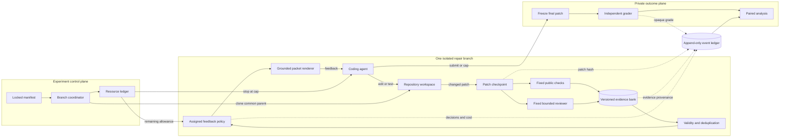
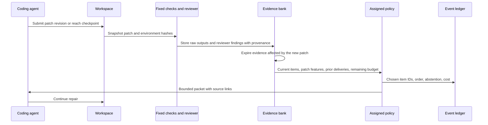
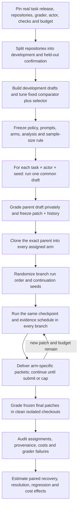

# VERITAS: Evidence Selection for Repository Repair

**Architecture and confirmatory experiment specification · Proposed design · 21 October 2026**

## 1. Research contract

> **Primary question:** Starting from the same incorrect repository patch, can a controller that
> selects *current, runtime-visible verifier evidence* at successive repair checkpoints improve
> final patch correctness over the strongest fixed-feedback policy under the same total resource
> budget?

This study evaluates **which evidence to show a coding agent as its patch changes**. The agent,
available checks, reviewer, checkpoint schedule, and stopping rules are fixed across conditions.
The controller can select, order, or withhold evidence; it cannot edit code, invent a diagnosis,
request additional tests, read private grading data, or decide that a patch is correct.

| Design choice | Frozen specification |
|---|---|
| **Population** | Real repository issue tasks with pinned checkouts and reproducible independent graders. |
| **Experimental block** | One task × actor × draft seed. Every condition begins from the same frozen parent patch, workspace, and actor history. |
| **Treatment** | A frozen policy selects current evidence at each eligible checkpoint. |
| **Primary control** | Strongest fixed actionable feedback policy chosen on development repositories. |
| **Primary estimand** | Paired difference in final resolution probability among parent drafts graded incorrect *before* condition assignment. |
| **Budget** | Equal total resource credits per continuation, including common verification, model calls, tests, tools, and selector overhead. |
| **Guardrail outcome** | Regression rate among initially correct drafts and on pre-existing tests. |

The proposed benchmark is a **feedback-selection evaluation protocol over existing repository
tasks**. A claim of a new standalone benchmark would require additional task construction,
annotation, validity analysis, and a public release. Novelty is conditional on a systematic review
and a held-out improvement over strong fixed feedback.

## 2. Closest work and the remaining question

| Work | Established contribution | Remaining question addressed here |
|---|---|---|
| [FeedbackEval](https://arxiv.org/abs/2504.06939) (2025 preprint, revised 2026) | Compares six feedback types and iterative repair across HumanEval, CoderEval, and a SWE-bench Verified subset. Its benchmark uses erroneous code instances; the SWE-bench subset is described as single-function focused. Its LLM-Expert feedback can use the reference implementation. | Does a policy selecting evidence across an actual agent's changing repository patch outperform a strong fixed package using only deployable evidence? |
| [Structured Feedback Improves Repair in an LLM Agent Loop](https://arxiv.org/abs/2607.14167) (2026 preprint) | Uses a prototype called VeriHarness to compare raw diagnostics with location, observed value, and admissible alternatives under equal call limits, mainly on TextWorld. The paper states repository-scale repair was not tested. | Does selecting among such actionable signals help during repository repair, beyond always providing the same structured fields? |
| [VeriHarness: Scaling Agentic Verification for Long-Horizon Tasks](https://arxiv.org/abs/2610.00972) (2026 preprint) | A separate work with the VeriHarness name; it uses workspace evidence tools and verification skills to guide selection and revision across long-horizon tasks. | It is a close conceptual competitor. A full method comparison is required before claiming a distinct evidence-selection contribution in repository repair. |
| [LLM-as-a-Verifier](https://arxiv.org/abs/2607.05391) (2026 preprint) | Fine-grained scores, criteria decomposition, repeated evaluation, and candidate ranking, including SWE-bench Verified evaluation. | Does the choice of evidence shown to the *repairing agent* improve its later patch, rather than only scoring or ranking a candidate? |
| [Agentic Rubrics](https://aclanthology.org/2026.acl-long.697/) (ACL 2026) | Builds repository-grounded criteria for patch evaluation. | Can execution evidence and reviewer findings be selected as a patch evolves? Repository-specific criteria alone are prior art. |
| [EGSS](https://aclanthology.org/2026.acl-long.1359/) (ACL 2026) | Uses entropy-guided search and test-suite augmentation under limited computation. | Does adaptive *feedback content* add value when the check schedule and search allowance are held fixed? |
| [Scaling Agentic Verifier](https://proceedings.mlr.press/v306/ma26av.html) (ICML 2026) | Searches for discriminative test inputs in competitive coding. | The proposed policy selects from existing evidence in repository repair; active test generation is outside this experiment. |

These papers make generic claims about actionable feedback, LLM verification, contextual criteria,
adaptive effort, or test generation unsuitable as the main novelty claim. The specific gap above is
a **hypothesis**, not proof that no comparable method exists.

## 3. Architecture: control, evidence, and evaluation boundaries

**Trust boundary:** only public issue data, repository contents, actor-visible tool results, public
checks, and bounded reviewer findings enter the runtime. The independent grader and reference
patches are available only to the outcome plane. Reviewer statements are labeled as model
opinions; they never become ground truth merely because a reviewer produced them.

### 3.1 One checkpoint cycle

The first checkpoint follows the frozen draft. Later checkpoints occur after each completed code
edit that changes the workspace tree hash, before the next actor model call, up to a maximum `K`
chosen on development data. The same trigger and evidence-generation procedure run in every
condition. After `K` checkpoints, the actor can continue with its remaining allowance but receives
no further controller packet. Submission or budget exhaustion ends the branch. The policy does not
control the trigger or stopping rule; that keeps the experiment focused on feedback selection.

## 4. Data and policy contracts

### 4.1 Patch and evidence records

Every checkpoint stores `task_id`, `branch_id`, `checkpoint_id`, `parent_patch_hash`, current
`tree_hash`, environment/image hash, changed files, actor history hash, remaining budget, and
timestamp. Every evidence item stores:

| Field | Purpose |
|---|---|
| `evidence_id`, `source`, `basis` | Identifies a test, build check, static analyzer, actor tool result, or model reviewer finding; distinguishes observed behavior from model opinion. |
| `patch_hash`, `environment_hash`, `command`, `raw_artifact_hash` | Shows exactly which code and environment produced the result. |
| `claim`, `location`, `observed`, `expected_if_observed` | Supplies a bounded, inspectable diagnostic. Expected behavior is included only if exposed by a public check or public task statement. |
| `affected_files`, `tests`, `related_ids` | Supports relevance, deduplication, and source tracing. |
| `status`, `invalidated_reason`, `created_at`, `cost` | Records whether the item can support feedback for the current patch and what obtaining it cost. |

**Conservative validity rule:** an execution result is current only for the exact tree and
environment hashes on which it ran. Any code or environment change expires that result until the
same check is rerun. Repository facts from unchanged files and the issue statement can remain
available, but are relabeled if their source changes. Reviewer findings are tied to the reviewed
patch hash. An expired item remains in the audit ledger and cannot be presented as evidence about
the current patch. The first study uses this conservative rule in every arm; more selective
dependency-based reuse can be evaluated later.

### 4.2 Evidence production

At each checkpoint, a fixed schedule runs available targeted tests, relevant existing tests chosen
by a frozen change-based rule, and supported build/static checks. Run them in a disposable copy of
the current patch state so caches, generated files, or test side effects cannot change the actor's
workspace. Run one bounded reviewer call at each checkpoint to turn the public issue, diff, and
public results into cited finding cards. Its prompt, model, input cap, and cost are identical in
all arms. The reviewer cannot access hidden tests, a gold patch, or the independent grade. A
failed reviewer call or unsupported check is recorded as unavailable; it is never silently
interpreted as a pass.

This design holds verification *opportunity* constant. It measures the value of selecting what the
agent sees. An adaptive test-selection study would require a separate experiment.

### 4.3 Feedback policy

At checkpoint `t`, the selector receives the current patch summary, current evidence cards, cards
already delivered, and remaining budget. It returns an ordered subset of evidence IDs or an
explicit abstention. The renderer uses one frozen format and token cap for all feedback arms.

A concrete first policy can score each valid card using public, measurable features:

`score(e,t) = w1·patch_relevance + w2·failure_severity + w3·source_reliability + w4·new_information − w5·redundancy − w6·packet_cost`

Select the highest-scoring nonredundant cards that fit the packet cap. Estimate weights and
thresholds only on development repositories, then freeze them. A more complex learned value
model is optional only if development data support it. The score is a decision aid, not a proof of
correctness. If every card is invalid or unhelpful, the policy abstains and sends a neutral packet.
On selector timeout or error, record and charge the attempt, deliver the same neutral packet, and
keep the assigned branch in the intention-to-treat analysis.

### 4.4 Fixed behavior across arms

The actor model, initial prompt, tool permissions, checkpoint trigger, check schedule, reviewer,
packet renderer, maximum checkpoint count, and stop conditions remain fixed within each actor
block. Agents may take different actions after receiving different packets; those downstream
differences are part of the policy effect.

## 5. End-to-end experimental design

### 5.1 Tasks, development, and confirmation

Use actual repository checkouts from a frozen task release with documented independent graders.
Audit task ambiguity, flaky tests, missing environments, and leakage before inclusion. Split by
repository when the task pool permits so policy tuning does not see the confirmation repositories.
Keep synthetic/mutation tasks in an engineering development set, not the primary result.

On development repositories, first demonstrate that snapshots, branch replay, evidence collection,
cost accounting, and grading work. Choose the fixed actionable template by highest development
recovery at the predeclared budget, breaking ties by lower measured cost, and fit the selector
there.
If developing a learned selector, randomize candidate packet choices in development and log their
assignment probabilities; final success labels alone do not identify the causal value of each
individual evidence card. Freeze all policy weights, prompts, thresholds, and fallbacks before
confirmatory runs.

### 5.2 Common parent and branch assignment

For each task × actor × seed, run one draft attempt from a clean checkout. Save the exact workspace,
diff, actor conversation, tool observations, and usage. A timeout, empty diff, or invalid draft is
retained. Grade this *parent* patch privately before the arm-specific continuation; keep its label
out of every prompt and policy input.

Clone the parent state into each arm. Prespecify independent continuation seeds where stochastic
decoding is used, and preserve their mapping to each parent block. Randomize branch execution
order within the block. The initial incorrectness label is
measured before treatment, so it can define the recovery cohort without selecting on a treatment
outcome. Preserve initially correct drafts for regression and full-cohort resolution estimates.

### 5.3 Arms and causal comparisons

| Arm | Evidence delivered at each checkpoint | Purpose |
|---|---|---|
| **A · Generic retry** | Neutral packet. Checks still run and are charged, but their results are concealed from the actor. | Isolates the information value of feedback from another attempt. A separate no-check retry can estimate deployment cost. |
| **B · Raw diagnostics** | Raw check outputs truncated by the common packet cap. | Execution-feedback baseline. |
| **C · Best fixed actionable** | Frozen development-selected template: location, observed behavior, and source-supported expected behavior or alternatives when available. | **Primary comparator.** |
| **D · Fixed combined** | All eligible current cards in a frozen order, truncated by the cap. | Tests whether selection helps beyond fixed aggregation. |
| **E · Adaptive selection** | Frozen selector chooses current cards and order, with abstention allowed. | Proposed method. |

All five arms use the same evidence producer and reviewer. Arm C must be selected on development
data, never chosen after seeing confirmation results. No arm receives expert guidance derived from
a reference patch. The primary test is **E versus C**; A, B, and D explain what kind of feedback
value, if any, the selector adds.

### 5.4 Resource matching and stopping

Fix a resource-credit formula before confirmation using measured model usage and test/tool time on
the actual study hardware or pinned provider prices. For local execution, one defensible definition
is `credits = GPU_seconds × pinned_GPU_rate + CPU_seconds × pinned_CPU_rate`; add billed API cost if
hosted calls are used. Calibrate the rates before confirmation and run branches without concurrent
jobs that would make resource attribution ambiguous. Charge common checks and reviewer calls to
every arm; charge selector work only to E. Each branch has the same total credit cap and a
wall-time cap. Selector overhead therefore reduces E's remaining actor allowance. Report raw
tokens by model, CPU/GPU seconds, test time, wall time, and monetary cost. If complete resource
measurement is unavailable, describe the comparison as matched *operational limits* and do not
claim equal compute from token counts alone.

Run a secondary **equal actor allowance** analysis with selector overhead shown separately. It
answers a different deployment question and cannot replace the primary equal-total-budget result.
The same maximum checkpoint count and stop rule apply to all arms. When the budget is exhausted,
freeze the last durable patch and record the exhaustion; do not allow an extra uncharged revision.

### 5.5 Final grading and failure handling

After the actor submits or stops, freeze and hash the final patch. Apply it to a fresh pinned
checkout and run the benchmark grader in an isolated environment. Persist raw reports and one
status: `resolved`, `unresolved`, `infrastructure_error`, `grader_error`, or `ungradable`.
Follow a predeclared retry rule for infrastructure failures. Report all assigned branches,
including errors, timeouts, empty patches, and policy abstentions. Grader output has no path back
to any active agent branch.

## 6. Analysis plan

### Primary effect

For parent drafts graded incorrect before branching, calculate the paired difference:

`Δrecovery = P(final resolved | E, parent incorrect) − P(final resolved | C, parent incorrect)`

Use intention-to-treat assignment: include all E and C branches regardless of whether the selector
found useful evidence, abstained, or failed. The confirmatory hypothesis is `Δrecovery > 0` at the
same resource cap. Report an effect size and interval even when it is not positive.

### Secondary effects

| Outcome | Why it is necessary |
|---|---|
| Full-cohort final resolution | Detects whether a gain conditional on failed parents matters across the task population. |
| Regression among initially correct parents | Detects damage caused by unnecessary feedback. |
| Regression on pre-existing tests | Detects repository behavior broken while fixing the issue. |
| Cost and wall time per resolved task | Prevents gains from being attributed to uncounted computation. |
| Feedback validity and use | Audits stale/unsupported cards and whether the actor acted on delivered findings. |
| Results by failure class and actor | Explains heterogeneity; these analyses are prespecified and secondary. |

Resample repositories and tasks as clusters, keeping all seeds and arms from each parent together,
to obtain intervals for paired risk differences. If the confirmation set contains too few
repositories for reliable repository-level inference, report task-paired estimates with explicit
limits on cross-repository generalization. Use a graded pilot to estimate the failed-parent rate,
paired discordance, clustering, missingness, and cost; set confirmatory sample size from those
values and a prespecified minimum meaningful effect. Do not set sample size after viewing the
confirmatory treatment effect.

### Mechanism ablations

Run these on development data first and confirm only prespecified contrasts with adequate power:

| Ablation | What it tests |
|---|---|
| Replace learned/tuned ranking with fixed source order | Whether policy selection adds value beyond formatting. |
| Remove patch relevance features | Whether conditioning on the changed code matters. |
| Remove evidence freshness filtering | Whether stale evidence changes decisions; never treat this unsafe variant as a deployable policy. |
| Remove novelty/deduplication features | Whether repeated findings waste packet budget. |

## 7. Implementation status in this repository

| Component | Status | Remaining work |
|---|---|---|
| [`feedback_evidence.py`](../src/veritas/feedback_evidence.py) | Implemented: typed checkpoint/evidence records, provenance checks, tree/environment invalidation, and tool-observation conversion. | Expand evidence producers beyond the current public/static pilot sources. |
| [`feedback_policy.py`](../src/veritas/feedback_policy.py) | Implemented: five packet policies with a shared character cap and adaptive selection scores/rejection reasons. | Freeze policy weights and the strongest fixed comparator on development repositories before confirmation. |
| [`runtime.py`](../src/veritas/runtime.py) `run_phase()` and [`feedback_runtime.py`](../src/veritas/feedback_runtime.py) | Implemented hook: detect patch changes and actor tool observations, refresh evidence packets, and expose the selected packet before the next actor request. | Add the planned model reviewer and broader shared test/build evidence producers. |
| [`feedback_study.py`](../src/veritas/feedback_study.py) and [`feedback_runner.py`](../src/veritas/feedback_runner.py) | Staged executor: image/grader fail-closed preflight, repository-disjoint development selection, frozen fixed baseline, confirmation parent screening, adaptive-vs-frozen-baseline continuation, hard per-task actor-resource cap, and repository-cluster bootstrap summary. | Complete a predeclared power analysis, validate upstream task/image provenance on the intended cohort, then run and audit the held-out comparison. |
| [`awareness_runtime.py`](../src/veritas/awareness_runtime.py) | Existing separate draft/review/revision experiment; not the proposed study runner. | Do not use its four factorial assignments as substitutes for the five paired feedback arms. |
| [`awareness_grading.py`](../src/veritas/awareness_grading.py) / [`swe.py`](../src/veritas/swe.py) | Existing pinned SWE grading and harness contracts. | Reuse to grade frozen parent/final patches, preserving infrastructure and grader errors as unknown outcomes. |
| [`controller.py`](../src/veritas/controller.py) | Existing action-time verifier controller; distinct from feedback selection. | No reuse as the proposed selector. |

## 8. Completion criteria

The current executor supports the staged protocol, but software support does not itself establish
benchmark validity, adequate power, or a positive effect. The archived 60-task pilot used local
fixture grading and is only engineering evidence. The new runner requires pinned images and official
grader metadata for benchmark plans, screens confirmation parents before branches, and enforces a
per-task resource cap. Before interpreting a held-out run, verify task provenance and complete a
power analysis using a valid development cohort. The parent screen must produce enough initially
incorrect drafts for the predeclared minimum; a floor or ceiling actor cannot identify the policy
effect well.

A positive contribution requires E to outperform C on held-out repair recovery or the
reliability-cost frontier without a material regression increase. A null result remains valuable
if the protocol reveals when fixed actionable feedback is already sufficient. Neither outcome
establishes priority over unreviewed literature; that requires the systematic search.
