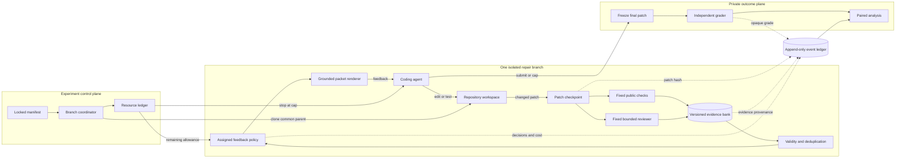
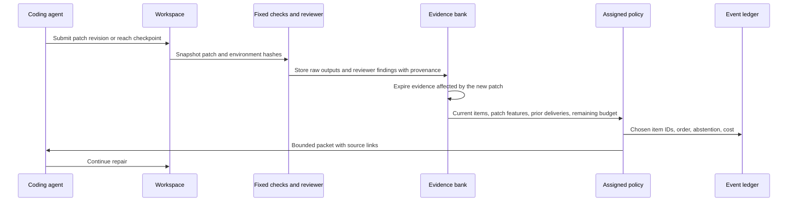
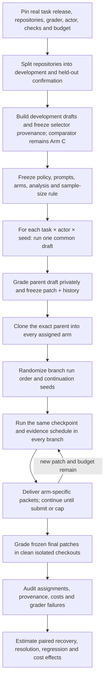

# VERITAS: Evidence Selection for Repository Repair

**Architecture and evaluation methodology · Implementation guide · 3 November 2026**

## 1. Research contract

> **Primary question:** Does adaptively selecting fresh, runtime-visible repair evidence improve
> repository-level bug recovery over the strongest fixed actionable-feedback policy under a matched
> operational budget?

This study evaluates **which evidence to show a coding agent as its patch changes**. The agent,
available checks, reviewer, checkpoint schedule, and stopping rules are fixed across conditions.
The controller can select, order, or withhold evidence; it cannot edit code, invent a diagnosis,
request additional tests, read private grading data, or decide that a patch is correct.

| Design choice | Frozen specification |
|---|---|
| **Population** | Real repository issue tasks with pinned checkouts and reproducible independent graders. |
| **Experimental block** | One task × actor × draft seed. Every condition begins from the same frozen parent patch, workspace, and actor history. |
| **Treatment** | A frozen policy selects current evidence at each eligible checkpoint. |
| **Primary control** | Strongest fixed actionable feedback policy chosen on development repositories. |
| **Primary estimand** | Paired F−C difference in final resolution probability among parent drafts graded incorrect *before* condition assignment. |
| **Budget** | Each branch starts with the common parent spend and uses the same hard total-credit cap and wall-time ceiling; evidence/tool/model and selector costs are charged to that budget. Audit actual per-arm spend and cap behavior in the pilot before claiming operational matching. |
| **Guardrail outcome** | Regression rate among initially correct drafts and on pre-existing tests. |

The proposed benchmark is a **feedback-selection evaluation protocol over existing repository
tasks**. A claim of a new standalone benchmark would require additional task construction,
annotation, validity analysis, and a public release. Novelty is conditional on a systematic review
and a held-out improvement over strong fixed feedback.

## 2. Closest work and the remaining question

| Work | Established contribution | Remaining question addressed here |
|---|---|---|
| [FeedbackEval](https://arxiv.org/abs/2504.06939) (2025 preprint, revised 2026) | Compares six feedback types and iterative repair across HumanEval, CoderEval, and a SWE-bench Verified subset. Its benchmark uses erroneous code instances; the SWE-bench subset is described as single-function focused. Its LLM-Expert feedback can use the reference implementation. | Does a policy selecting evidence across an actual agent's changing repository patch outperform a strong fixed package using only deployable evidence? |
| [Structured Feedback Improves Repair in an LLM Agent Loop](https://arxiv.org/abs/2607.14167) (2026 preprint) | Uses a prototype called VeriHarness to compare raw diagnostics with location, observed value, and admissible alternatives under equal call limits, mainly on TextWorld. The paper states repository-scale repair was not tested. | Does selecting among such actionable signals help during repository repair, beyond always providing the same structured fields? |
| [VeriHarness: Scaling Agentic Verification for Long-Horizon Tasks](https://arxiv.org/abs/2610.00972) (2026 preprint) | A separate work with the VeriHarness name; it uses workspace evidence tools and verification skills to guide selection and revision across long-horizon tasks. | It is a close conceptual competitor. A full method comparison is required before claiming a distinct evidence-selection contribution in repository repair. |
| [LLM-as-a-Verifier](https://arxiv.org/abs/2607.05391) (2026 preprint) | Fine-grained scores, criteria decomposition, repeated evaluation, and candidate ranking, including SWE-bench Verified evaluation. | Does the choice of evidence shown to the *repairing agent* improve its later patch, rather than only scoring or ranking a candidate? |
| [Agentic Rubrics](https://aclanthology.org/2026.acl-long.697/) (ACL 2026) | Builds repository-grounded criteria for patch evaluation. | Can execution evidence and reviewer findings be selected as a patch evolves? Repository-specific criteria alone are prior art. |
| [EGSS](https://aclanthology.org/2026.acl-long.1359/) (ACL 2026) | Uses entropy-guided search and test-suite augmentation under limited computation. | Does adaptive *feedback content* add value when the check schedule and search allowance are held fixed? |
| [Scaling Agentic Verifier](https://proceedings.mlr.press/v306/ma26av.html) (ICML 2026) | Searches for discriminative test inputs in competitive coding. | The proposed policy selects from existing evidence in repository repair; active test generation is outside this experiment. |

These papers make generic claims about actionable feedback, LLM verification, contextual criteria,
adaptive effort, or test generation unsuitable as the main novelty claim. The specific gap above is
a **hypothesis**, not proof that no comparable method exists.

## 3. Architecture: control, evidence, and evaluation boundaries

**Trust boundary:** only public issue data, repository contents, actor-visible tool results, public
checks, and bounded reviewer findings enter the runtime. The independent grader and reference
patches are available only to the outcome plane. Reviewer statements are labeled as model
opinions; they never become ground truth merely because a reviewer produced them.

### 3.1 One checkpoint cycle

The initial evidence snapshot follows the frozen draft and is not counted as a patch change.
Subsequent patch checkpoints occur when the generated patch hash changes, before the next actor
model call, up to a maximum `K` patch changes. Same-patch tool observations refresh evidence but do
not consume this ceiling. After `K` patch changes, the actor can continue within its revision-step
and credit allowances but receives no further controller packet. `revision_steps` and `max_steps`
count actor model requests that ask for another repair; tool observations do not consume that
allowance. `actual_revision_steps_taken` is the number of such requests actually sent. The policy
does not control these triggers or stopping rules.

## 4. Data and policy contracts

### 4.1 Patch and evidence records

Every checkpoint stores `task_id`, `branch_id`, `checkpoint_id`, `parent_patch_hash`, current
`tree_hash`, environment/image hash, changed files, actor history hash, remaining budget, and
timestamp. Every evidence item stores:

| Field | Purpose |
|---|---|
| `evidence_id`, `source`, `basis` | Identifies a test, build check, static analyzer, actor tool result, or model reviewer finding; distinguishes observed behavior from model opinion. |
| `patch_hash`, `environment_hash`, `command`, `raw_artifact_hash` | Shows exactly which code and environment produced the result. |
| `claim`, `location`, `observed`, `expected_if_observed` | Supplies a bounded, inspectable diagnostic. Expected behavior is included only if exposed by a public check or public task statement. |
| `affected_files`, `tests`, `related_ids` | Supports relevance, deduplication, and source tracing. |
| `status`, `invalidated_reason`, `created_at`, `cost` | Records whether the item can support feedback for the current patch and what obtaining it cost. |

**Conservative validity rule:** an execution result is current only for the exact tree and
environment hashes on which it ran. Any code or environment change expires that result until the
same check is rerun. Repository facts from unchanged files and the issue statement can remain
available, but are relabeled if their source changes. Reviewer findings are tied to the reviewed
patch hash. An expired item remains in the audit ledger and cannot be presented as evidence about
the current patch. The first study uses this conservative rule in every arm; more selective
dependency-based reuse can be evaluated later.

### 4.2 Evidence production

The current runner uses public issue text, `git diff --check`, changed-file Python syntax checks,
change-based targeted pytest when matching test files exist, and actor tool observations. These
checks run in a disposable copy. A model reviewer is optional in the producer API but is not
enabled by the current CLI study path. Unsupported checks and failures are recorded as unavailable
or failed, never as passes. Expected behavior is rendered only when source-supported; model opinion
remains labeled as such. Evidence carries patch/tree/environment hashes and expires on a relevant
state change.

This design holds verification *opportunity* constant. It measures the value of selecting what the
agent sees. An adaptive test-selection study would require a separate experiment.

### 4.3 Feedback policy

At checkpoint `t`, the selector receives current evidence cards, cards
already delivered, and remaining budget. It returns an ordered subset of evidence IDs or an
explicit abstention. The renderer uses one frozen format and token cap for all feedback arms.

A concrete first policy can score each valid card using public, measurable features:

`score(e,t) = w1·patch_relevance + w2·failure_severity + w3·source_reliability + w4·new_information − w5·redundancy − w6·packet_cost`

Select the highest-scoring cards that fit the packet cap. The current adaptive arm uses frozen
heuristic weights; the fixed actionable arm orders cards by checkpoint recency and severity. Both
use the richer evidence renderer. The selector score is a decision aid, not a proof of correctness.
If no evidence fits, the policy abstains and sends a neutral packet.
On selector timeout or error, record and charge the attempt, deliver the same neutral packet, and
keep the assigned branch in the intention-to-treat analysis.

### 4.4 Fixed behavior across arms

The actor model, initial prompt, tool permissions, checkpoint trigger, check schedule, reviewer,
packet renderer, maximum checkpoint count, and stop conditions remain fixed within each actor
block. Agents may take different actions after receiving different packets; those downstream
differences are part of the policy effect.

### 4.5 Controller interface and LinUCB arm

`feedback_controller.py` defines a separate extensible interface for future evidence-action
selection. Its initial action catalog is concise failure summary, location diagnostics,
source-supported expected-versus-observed behavior, and a complementary multi-source packet.
The builder admits only evidence matching the active task, branch, patch, tree, and environment;
it renders packets from stored evidence and returns action IDs with evidence references. The
controller contract receives a numeric state vector and current valid actions, then returns one
valid ID. Modular feature extractors cover failure category/severity and counts, patch size,
measured public progress, exact-hash freshness, remaining budget, action history, and optional
repository-separated public-history signals. Novelty/discrimination features can be added as
extractors. This interface is wired into a separate LinUCB arm. `LinUCBController` is the primary
learned controller implementation: it uses one shared state vector and disjoint `A_a`, `b_a`
statistics per action. Learning mode uses configurable `alpha`, supports delayed online updates
and offline warm-start, and charges selection, update, and fit credits through a required budget
callback. Frozen evaluation mode has no exploration or updates and requires a repository-audited
policy artifact. An independent grade may be delivered only as a post-trajectory training reward
for development repositories disjoint from evaluation; it never enters actor-visible feedback,
decision-time features, or held-out policy updates. The implementation is connected to Arm F in the
paired study runner. It has not yet been exercised in a full
SWE-rebench pilot, so accounting and trajectory behavior still require pilot validation.

Outcome rewards are built separately in `feedback_reward.py`. The default gives `+1` only for an
independent-grader success and `-lambda_c × measured_cost` for a known failure; unknown grader or
infrastructure outcomes produce no reward. Cost combines the selected action and subsequent agent
step, with configurable resource coefficients. Optional regression penalty, reliable public
progress shaping, and terminal/uniform/discounted delayed-credit allocation are explicit settings.
Packet length and model preference are never reward signals. Official outcomes are evaluator-side
and may be used only in training-repository trajectories, never in held-out controller inputs.

## 5. End-to-end experimental design

### 5.1 Tasks, development, and confirmation

Use actual repository checkouts from a frozen task release with documented independent graders.
Audit task ambiguity, flaky tests, missing environments, and leakage before inclusion. Split by
repository when the task pool permits so policy tuning does not see the confirmation repositories.
Keep synthetic/mutation tasks in an engineering development set, not the primary result.

On development repositories, first demonstrate that snapshots, branch replay, evidence collection,
cost accounting, and grading work. Choose the fixed actionable template by highest development
recovery at the predeclared budget, breaking ties by lower measured cost, and fit the selector
there.
If developing a learned selector, randomize candidate packet choices in development and log their
assignment probabilities; final success labels alone do not identify the causal value of each
individual evidence card. Freeze all policy weights, prompts, thresholds, and fallbacks before
confirmatory runs.

### 5.2 Common parent and branch assignment

For each task × actor × seed, run one draft attempt from a clean checkout. Save the exact workspace,
diff, actor conversation, tool observations, and usage. A timeout, empty diff, or invalid draft is
retained. Grade this *parent* patch privately before the arm-specific continuation; keep its label
out of every prompt and policy input.

Clone the parent state into each arm. Prespecify independent continuation seeds where stochastic
decoding is used, and preserve their mapping to each parent block. Randomize branch execution
order within the block. The initial incorrectness label is
measured before treatment, so it can define the recovery cohort without selecting on a treatment
outcome. Preserve initially correct drafts for regression and full-cohort resolution estimates.

### 5.3 Arms and causal comparisons

| Arm | Evidence delivered at each checkpoint | Purpose |
|---|---|---|
| **A · Generic retry** | Neutral packet. Checks still run and are charged, but their results are concealed from the actor. | Isolates the information value of feedback from another attempt. A separate no-check retry can estimate deployment cost. |
| **B · Raw diagnostics** | Raw check outputs truncated by the common packet cap. | Execution-feedback baseline. |
| **C · Fixed actionable** | Predeclared strongest fixed actionable template: location, observed behavior, and source-supported expected behavior or alternatives when available. | **Primary comparator, frozen before results.** |
| **D · Fixed combined** | All eligible current cards in a frozen order, truncated by the cap. | Secondary comparator for selection versus fixed aggregation. |
| **E · Adaptive selection** | Rule-based adaptive selector chooses from current valid evidence. | Secondary adaptive baseline. |
| **F · LinUCB** | Learned contextual selector chooses one predefined evidence action from the same current evidence. | Primary learned controller; compared with Arm C. |

All six arms use the same actor and evidence producer. Arm C is fixed in the plan protocol as the
primary comparator before development outcomes exist; development scores cannot switch it. Arm E
(rule-based adaptive) and D (fixed combined) are secondary baselines; A and B remain diagnostic.
No arm receives expert guidance derived from a reference patch. The primary learned-controller
test is **F (LinUCB) versus C**.

The current A–F study is evidence-selection only. There is no repair-strategy assignment,
`debug_existing_patch` action, `regenerate_from_issue` action, candidate portfolio, or learned routing
model. Phase 3 is conditional on trajectory review showing repeated wrong high-level strategy
choices and, if justified, must be a separate factorial experiment. Strategy and evidence policy
must be crossed independently; any two-candidate condition must be compute-matched to a
single-trajectory baseline.

### 5.4 Resource matching and stopping

The current implementation applies the same actor step limits, checkpoint cap, operational-credit
cap, and wall-time budget to paired branches. Each branch begins with shared parent spend already
charged. LinUCB feature construction, selection, updates, and fitting are charged to Arm F through
the same branch budget; Arm E uses the rule-based selector. Equal caps do not imply equal realized
spend or equal hardware compute, so report costs by arm and call the design matched operational
limits unless compute is directly measured and balanced.

### 5.5 Run sequence and evaluation

1. Prepare and validate the pinned dataset. Generate the SWE task image map with the same source
   and split that will be used in the plan. Do not substitute a local fixture for benchmark tasks.
2. Create an immutable plan with repository-disjoint development and confirmation partitions.
   Confirm the plan's task/repository counts and power assumptions before model inference.
3. Run development branches, inspect evidence/event logs and termination reasons, then freeze the
   development artifact. Arm C stays the predeclared comparator; development results do not select
   a different primary comparator.
4. Run confirmation in two stages: `--parents-only` first to privately grade the common parent
   patches, then treatment branches only if the predeclared incorrect-parent gate is satisfied.
   Parent grades and official/hidden grading outputs remain evaluator-side and must not be included
   in agent prompts, evidence packets, or selector inputs.
5. Analyze confirmation only after all eligible paired outcomes are complete. Report paired F vs C
   recovery difference among initially incorrect parents, full-cohort resolution, regression among
   initially correct parents, pre-existing-test regressions, infrastructure/grader failures,
   credits, wall time, and `revision_termination_reason` counts. Keep development descriptive.

The code logs packet decisions, action scores, exploration bonuses, feature state, rewards where
available, and trajectory outcomes. Actual information use is not reliably detectable yet; whether
the next patch improved can be derived as a trajectory outcome, but it is not causal credit for one
packet. Treat these as instrumentation limits. A 5–10 block development diagnostic is useful for
pipeline and termination inspection, but it does not establish power or a confirmatory result. Do
not train or run LinUCB until the Phase 1 invariants and pilot logging have been reviewed.

The operational-credit formula currently used by the runner is
`(prompt_tokens + completion_tokens) × 0.002 + measured_sandbox_or_evidence_seconds × 0.05 + selector_overhead`.
This is an operational accounting unit, not a claim of equal GPU/CPU compute or monetary cost.
The shared parent draft is included in each branch's cap; independent official grading and image
setup are excluded and reported separately. The same hard credit cap and wall-time ceiling apply to
all arms, and selector overhead reduces F's remaining actor allowance. Report raw tokens, tool/test
calls, wall time, credit use, budget exhaustion, and per-arm resolved-task cost. Freeze any revised
cost formula before confirmation.

The same maximum patch-change count, revision-attempt count, and stop rule apply to all arms.
Each result records patch changes, same-patch evidence refreshes, revision attempts, model calls,
tool calls, operational credits, wall time, and a normalized termination reason. Credits use the
frozen runner formula described above;
the common parent draft is included in each branch's per-arm cost, while independent official
grading and image setup are excluded and reported separately. When the budget is exhausted, freeze
the last durable patch and record the exhaustion; do not allow an extra uncharged revision.

### 5.5 Final grading and failure handling

After the actor submits or stops, freeze and hash the final patch. Apply it to a fresh pinned
checkout and run the benchmark grader in an isolated environment. Persist raw reports and one
status: `resolved`, `unresolved`, `infrastructure_error`, `grader_error`, or `ungradable`.
Follow a predeclared retry rule for infrastructure failures. Report all assigned branches,
including errors, timeouts, empty patches, and policy abstentions. Grader output has no path back
to any active agent branch.

The result row and trajectory summary store a normalized revision termination reason, revision
error, budget exhaustion flag, final public-check status, evaluator-side official-grade status,
patch emptiness, patch-change count, and actual revision steps. Failed rows may carry multiple
failure-taxonomy tags: `empty_patch`, `non_empty_incorrect_patch`,
`public_tests_pass_but_official_fail`, `agent_could_not_act / tool_error`, and
`early_stop_without_budget_exhausted`. Public-check summaries are computed from checks run against
the final patch; official grader outcomes remain evaluator-side and are never rendered into actor
feedback.

## 6. Analysis plan

### Primary effect

For parent drafts graded incorrect before branching, calculate the paired difference:

`Δrecovery = P(final resolved | F, parent incorrect) − P(final resolved | C, parent incorrect)`

Use intention-to-treat assignment: include all F and C branches regardless of whether the selector
found useful evidence, abstained, or failed. The confirmatory hypothesis is `Δrecovery > 0` at the
same resource cap. Report an effect size and interval even when it is not positive.

### Secondary effects

| Outcome | Why it is necessary |
|---|---|
| Full-cohort final resolution | Detects whether a gain conditional on failed parents matters across the task population. |
| Regression among initially correct parents | Detects damage caused by unnecessary feedback. |
| Regression on pre-existing tests | Detects repository behavior broken while fixing the issue. |
| Cost and wall time per resolved task | Prevents gains from being attributed to uncounted computation. |
| Feedback validity and use | Audits stale/unsupported cards and whether the actor acted on delivered findings. |
| Results by failure class and actor | Explains heterogeneity; these analyses are prespecified and secondary. |

Resample repositories and tasks as clusters, keeping all seeds and arms from each parent together,
to obtain intervals for paired risk differences. If the confirmation set contains too few
repositories for reliable repository-level inference, report task-paired estimates with explicit
limits on cross-repository generalization. Use a graded pilot to estimate the failed-parent rate,
paired discordance, clustering, missingness, and cost; set confirmatory sample size from those
values and a prespecified minimum meaningful effect. Do not set sample size after viewing the
confirmatory treatment effect.

### Recommended evaluation matrix for training and testing

Report the following metrics using their stated units and denominators. The issue-level repair
outcomes and action-level controller outcomes answer different questions and must not be pooled.

| # | Metric | Definition or reporting rule | Priority |
|---|---|---|---|
| 1 | Resolved rate (SWE-bench) | Issues resolved by the independent grader ÷ issues attempted. | Essential |
| 2 | Regression-free rate | Patches passing the predeclared regression checks ÷ patches evaluated. | Essential |
| 3 | Recovery rate on initially incorrect tasks | Final independently graded resolutions ÷ parent patches graded incorrect before treatment; report paired F and C outcomes. | Primary |
| 4 | Full-cohort resolution | Final independently graded resolutions ÷ all attempted parent tasks. | Essential |
| 5 | Regression rate | Initially correct parents made incorrect, and pre-existing tests broken, reported separately. | Essential |
| 6 | Cost per resolved issue | Operational credits, tokens, calls, test/tool time, and wall time per resolved task, by arm. | Essential |
| 7 | Termination and failure classes | `revision_termination_reason`, empty/non-empty incorrect patch, public-pass/official-fail, grader/infrastructure unknowns. | Essential |
| 8 | LinUCB behavior | Exploration/exploitation counts, action counts, score/bonus distributions, and valid-action availability. | Essential for controller audit |
| 9 | Evidence quality and use | Freshness, provenance, repeated packet exposure, next-patch progress, and observable use where detectable. | Recommended; report limits |
| 10 | Repository-clustered uncertainty | Paired F−C estimate and interval resampling repositories with arms/tasks kept together. | Essential |

Report issue-level outcomes for this study; do not import action-verification metrics from the
separate controller experiment. A failed public test is evidence about that check, not proof that a
patch is globally faulty. Classify infrastructure and grader failures separately, and keep their
outcomes unknown rather than counting them as patch failures or successes.

### Mechanism ablations

Use the six existing arms as the main policy comparison. They are not separate component
ablations: each has a distinct role, and the contrasts below should be declared before confirmation.

| Arm | Policy | Prespecified contrast | What the contrast can establish |
|---|---|---|---|
| A | Generic retry (neutral packet) | B − A | Value of exposing raw execution feedback over another repair attempt without findings. |
| B | Raw diagnostics | C − B | Value of converting raw output into a bounded, actionable feedback format. |
| C | Predeclared fixed actionable feedback | F − C (**primary**) | Whether LinUCB improves recovery over the strongest fixed policy under the same operational limits. |
| D | Fixed combined evidence | F − D (secondary) | Whether LinUCB improves over fixed aggregation. |
| E | Rule-based adaptive evidence selection | E − C (secondary) | Whether the current heuristic adaptive selector improves over the fixed baseline. |
| F | LinUCB contextual evidence selection | F − C (**primary**) | Main learned-policy estimate. |

The six arms are feedback-policy conditions, not component removals. Do not claim effects for
individual score features from this matrix. The primary confirmatory estimand is the paired F−C
difference in recovery among parent patches independently graded incorrect before treatment.
Also report full-cohort resolution, regression among initially correct parents, pre-existing-test
regression, infrastructure/grader unknowns, cost and wall-time distributions, and repository
clustered uncertainty. Treat B−A, C−B, and E−D as secondary or diagnostic contrasts, with
multiplicity handled if inferential claims are made.

## 7. Implementation status in this repository

| Component | Status | Remaining work |
|---|---|---|
| [`feedback_evidence.py`](../src/veritas/feedback_evidence.py) | Implemented: typed checkpoint/evidence records, source provenance, issue context, tree/environment invalidation, and tool-observation conversion. | Expected behavior and source locations are recorded only when supplied by a public source; audit extraction quality on development data. |
| [`feedback_policy.py`](../src/veritas/feedback_policy.py) | Implemented: fixed and rule-based evidence policies, shared packet cap, and auditable selection details. | Actual evidence use is not yet reliably measured. |
| [`feedback_controller.py`](../src/veritas/feedback_controller.py) / [`feedback_reward.py`](../src/veritas/feedback_reward.py) | Implemented: disjoint-action LinUCB, frozen/evaluation and learning modes, offline warm start, budget callback, configurable outcome reward, and delayed credit. | Run a small development pilot; audit reward rows, charged costs, and repository provenance before freezing a policy. |
| [`runtime.py`](../src/veritas/runtime.py) `run_phase()` and [`feedback_runtime.py`](../src/veritas/feedback_runtime.py) | Implemented hook: detect patch changes and actor tool observations, refresh evidence packets, and expose the selected packet before the next actor request. Enforces a fixed checkpoint ceiling and caps model/tool calls by the remaining wall budget. | Verify the cap under the target runtime and publish observed operational limits. |
| [`feedback_runner.py`](../src/veritas/feedback_runner.py) | Shared public producer: issue, diff check, disposable targeted tests, changed-file compile check, and actor tool observations. Optional reviewer API is not enabled by the CLI study path. | Audit source-to-test matching and evidence quality on development data. |
| [`feedback_study.py`](../src/veritas/feedback_study.py) and [`feedback_runner.py`](../src/veritas/feedback_runner.py) | Staged executor: pinned-image/official-grader preflight, repository-disjoint partitions, Arm C frozen as primary, parent screening, event/result ledgers, resource counters, and termination taxonomy. | Validate baseline freeze, checkpoint counts, empty-patch taxonomy, and budget charging in a pilot before bandit execution. |
| [`awareness_runtime.py`](../src/veritas/awareness_runtime.py) | Existing separate draft/review/revision experiment; not the proposed study runner. | Do not use its four factorial assignments as substitutes for the six paired feedback arms. |
| [`awareness_grading.py`](../src/veritas/awareness_grading.py) / [`swe.py`](../src/veritas/swe.py) | Existing pinned SWE grading and harness contracts. | Reuse to grade frozen parent/final patches, preserving infrastructure and grader errors as unknown outcomes. |
| [`controller.py`](../src/veritas/controller.py) | Legacy action-verification controller used by other runtime commands; it is not a feedback-selection arm. | Do not treat its verification policies as substitutes for the six paired feedback arms. |

## 8. Completion criteria

The current executor supports the staged protocol, but software support does not itself establish
benchmark validity, adequate power, or a positive effect. The archived 60-task pilot used local
fixture grading and is only engineering evidence. The new runner requires pinned images and official
grader metadata for benchmark plans, screens confirmation parents before branches, and enforces
matched operational credit and wall limits. The predeclared power calculation is an approximation
that uses assumed discordance and repository ICC; it cannot establish power from task count alone,
especially with few repositories. The parent screen must meet both the protocol's minimum and the
planned incorrect-parent count before a powered confirmatory claim. Default adaptive weights are
prespecified heuristics, not a learned selector; empirical tuning requires randomized development
packet assignment and must be frozen before confirmation.

A positive contribution requires F to outperform C on held-out repair recovery or the
reliability-cost frontier without a material regression increase. A null result remains valuable
if the protocol reveals when fixed actionable feedback is already sufficient. Neither outcome
establishes priority over unreviewed literature; that requires the systematic search.
